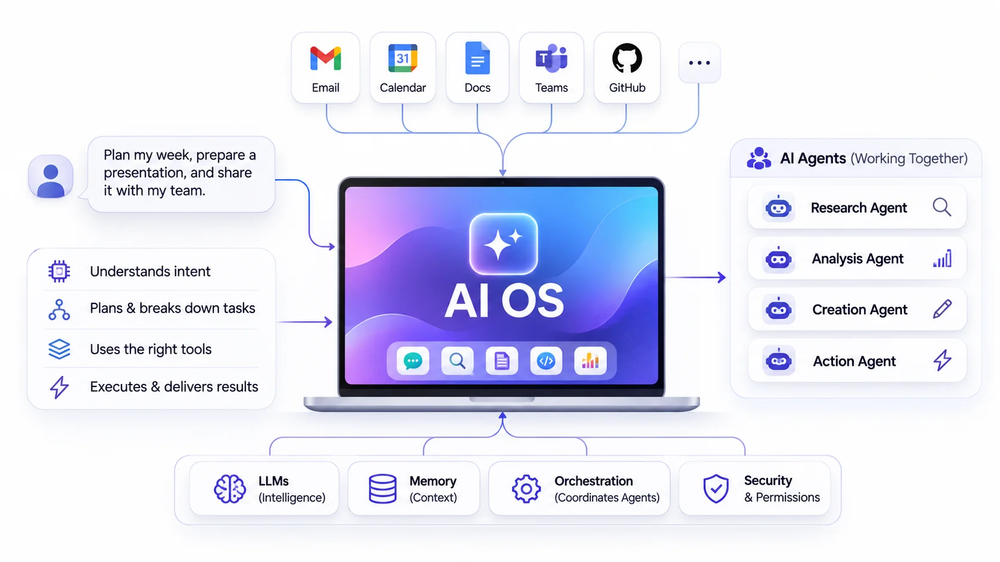
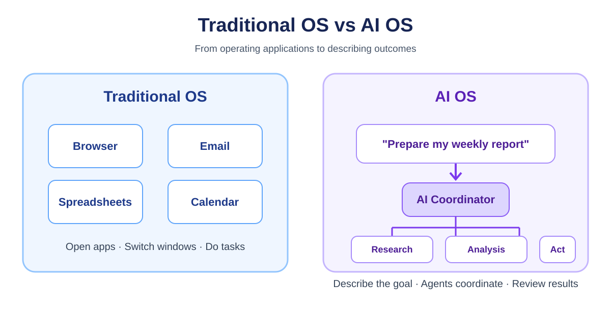
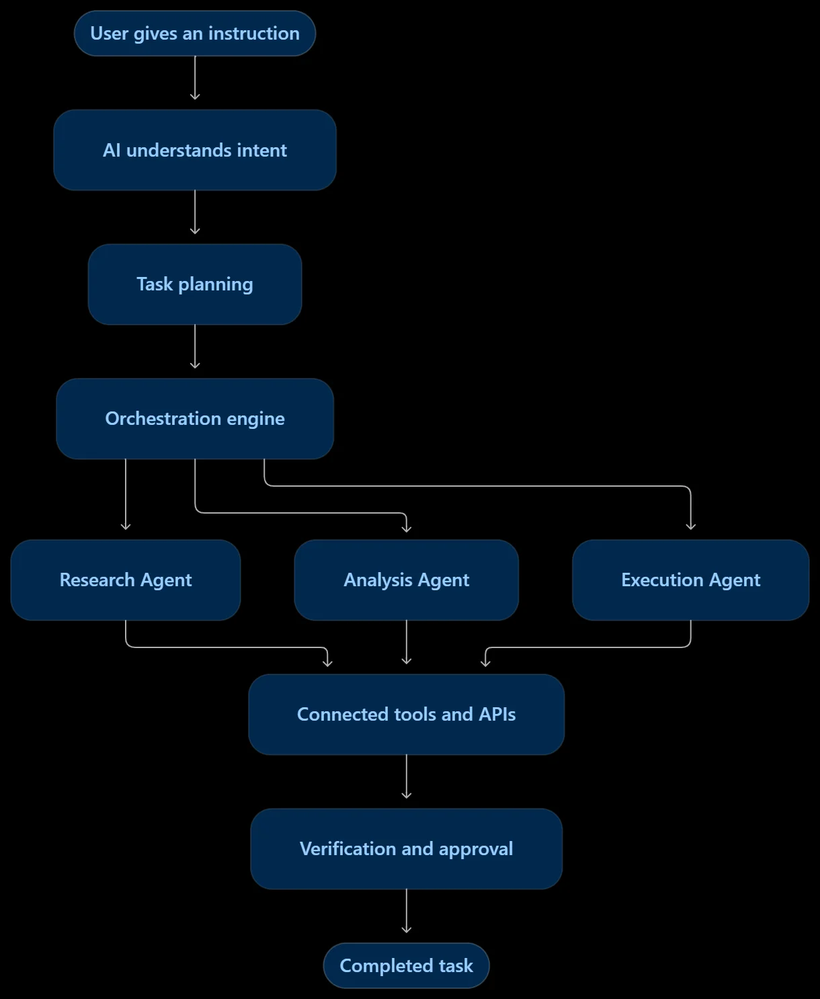

<figure class="post-figure" data-size="small"></figure>

## AI Operating System (AI OS): Is This the Future of Computing?

*From opening applications and clicking buttons to simply telling computers what we want. Discover how Artificial Intelligence is changing the way we interact with technology.*

Imagine starting your day by telling your computer:

"Check my emails, summarize the important ones, prepare a presentation for today's meeting, collect the latest market updates, and share everything with my team."

Your computer understands the request, breaks it into smaller tasks, uses different applications, gathers information, prepares the presentation, and brings everything together.

You don't have to open ten different applications or manually perform every step.

This is the idea behind an **AI Operating System (AI OS)**.

Artificial Intelligence is no longer limited to answering questions or generating text. It is gradually moving towards systems that can understand instructions, plan tasks, interact with applications, and perform actions independently.

But what exactly is an AI OS? How is it different from Windows or macOS? Are there any real examples today? And what could it mean for the future of work?

Let's explore.

---

## From Traditional Computing to Intelligent Computing

To understand why AI OS matters, let's first look at how we currently interact with computers.

Think about a normal working day. You open your browser to search for information, Excel to analyze data, Outlook to check emails, Teams to attend meetings, and other applications to complete your work.

Every application performs a specific function, but you are responsible for connecting all the steps.

This is how traditional computing works: **the user operates the applications to achieve an outcome.**

An AI-powered approach changes this interaction. Instead of navigating through different applications, you describe the outcome you want, and an intelligent system coordinates the required actions.



*The shift is from manually operating individual applications to describing an outcome and letting connected tools work together.*

## What Exactly Is an AI Operating System?

An Operating System (OS) is the fundamental software that manages a computer's hardware, software, memory, processes, and applications.

Some familiar examples are Windows, macOS, Linux, Android, and iOS.

An **AI Operating System** takes this concept further by introducing an intelligent layer that understands user intent, manages context, coordinates AI agents, and connects different tools and applications to complete tasks.

In simple words:

A traditional OS helps you operate your computer.

An AI OS aims to help your computer understand what you want to accomplish and work towards completing it.

It is important to understand that AI OS is an evolving concept, not one universally defined product or a completely new replacement for Windows and Linux.

Some implementations integrate AI into existing operating systems, while others build dedicated platforms for running and coordinating AI agents.

## How Is an AI OS Different From a Traditional OS?

The biggest difference is how users interact with technology.

| Traditional OS | AI OS |
| --- | --- |
| Application-driven | Intent-driven |
| Users manually open applications | AI can select and use tools |
| Executes predefined instructions | Can interpret and plan tasks |
| Limited understanding of context | Can use context and memory |
| Users connect individual workflows | Agents can coordinate workflows |
| Focuses on managing computing resources | Also coordinates intelligent tasks |

Consider this example.

You want to organize a business meeting.

With a traditional OS, you open your calendar, check availability, open email, draft invitations, and prepare an agenda.

With an AI OS, you could simply say:

"Schedule a meeting with the engineering team next week, find a suitable time, prepare an agenda, and send invitations."

The AI system can coordinate the necessary applications and services to accomplish the task, with your permission.

The difference is not simply speed. It is a change in how we communicate with computers.

## What Happens Inside an AI OS?

An AI OS is not just one large language model or a chatbot running in the background. It brings together several technologies that work as a coordinated system.

Here are some of its important building blocks:

| Component | Its role |
| --- | --- |
| Large Language Models (LLMs) | Understand instructions, interpret context, and reason about tasks |
| AI Agents | Perform specialized tasks such as research, coding, and analysis |
| Memory & Context | Retain useful information and previous interactions |
| Orchestration Engine | Coordinates agents and manages task execution |
| APIs & Tool Integrations | Connect with external applications, databases, and services |
| Security & Permissions | Controls what agents can access and which actions they can perform |

### Understanding the workflow through an example

Imagine asking your AI OS to prepare a report on the latest developments in Artificial Intelligence.

Instead of doing everything yourself, the system can follow a workflow:

<figure class="post-figure" data-size="small"></figure>

The process can be explained through a few simple steps:

- **Understanding:** The AI interprets what you are asking for.

- **Planning:** It divides the request into smaller tasks.

- **Delegation:** It assigns tasks to specialized agents.

- **Execution:** Agents use permitted tools, APIs, and data sources.

- **Verification:** The system checks whether the requested tasks were completed correctly.

- **Delivery:** The final output is presented to the user.

For example, a research agent can collect information, an analysis agent can identify important findings, and a writing agent can prepare the report.

The orchestration layer coordinates their work.

This is what makes an AI OS more interesting than an ordinary chatbot.

## AI Chatbots, AI Agents and AI OS: What Is the Difference?

These three terms are often used interchangeably, but they represent different capabilities.

| Capability | AI Chatbot | AI Agent | AI OS |
| --- | --- | --- | --- |
| Answers questions | Yes | Yes | Yes |
| Understands instructions | Yes | Yes | Yes |
| Performs actions | Tool-dependent | Yes | Coordinates actions |
| Uses external applications | Sometimes | Yes | Across connected systems |
| Handles multi-step tasks | Limited | Yes | Yes |
| Coordinates multiple agents | Usually not | Not necessarily | A central capability |
| Manages shared context and permissions | Application-dependent | Application-dependent | A broader system-level responsibility |

Think of an AI chatbot as someone who answers your questions.

An AI agent is someone who can take responsibility for a task.

An AI OS is the environment that brings multiple agents, tools, memory, and applications together to accomplish larger goals.

## Are AI Operating Systems Already Here?

Yes, but there is an important distinction.

We already have products and research projects moving towards AI-native and agent-based computing. However, they do not all represent the same thing.

Some are AI-enhanced operating systems, some are dedicated agentic operating systems, and others are enterprise platforms.

Here are some interesting examples.

### rabbit OS 3 – An Agentic Operating System

[rabbit OS 3](https://www.rabbit.tech/newsroom/rabbitos-3-launch), announced in September 2026, is an interesting example of the agentic OS direction.

Rather than requiring users to operate individual applications for every task, rabbit OS 3 provides a conversational interface where users describe the outcome they want.

It can coordinate connected AI models, web services, skills, and devices. Its desktop experience can also interact with Windows, macOS, and Linux devices through a connected agent.

The central idea is simple: tell the system what you want to accomplish, rather than manually managing every step.

### Android with Gemini Intelligence

Google is also moving Android towards a more intelligent operating experience.

With [Gemini Intelligence](https://blog.google/products-and-platforms/platforms/android/gemini-intelligence/), announced in May 2026, Google is bringing more proactive AI capabilities to Android, including automating multi-step tasks across applications.

Android is not being replaced by a separate AI OS here. Instead, intelligence is becoming a deeper part of the existing operating system.

### Windows Copilot+ PCs

Microsoft is integrating AI directly into Windows through Copilot+ PCs.

These devices include dedicated AI components and hardware, such as Neural Processing Units (NPUs), to run certain AI workloads locally.

This enables features such as AI-assisted image creation, editing, and language processing.

It is an example of an existing operating system becoming more AI-powered rather than a completely new AI OS.

### AIOS – LLM Agent Operating System (Research Project)

Another interesting example is [AIOS by AGI Research](https://github.com/agiresearch/AIOS).

Unlike consumer operating systems, this project focuses on building an operating system specifically for LLM-based agents.

It introduces an AIOS kernel that manages important resources such as:

- Agent scheduling

- Memory management

- Context management

- Storage management

- Access control

- LLM and tool resources

The objective is to provide a structured environment where multiple AI agents can run and interact more efficiently.

This is particularly interesting from a software engineering and AI research perspective.

### A Quick Comparison

| Product / Project | Main Focus | Category |
| --- | --- | --- |
| rabbit OS 3 | Conversational, multi-device task execution | Agentic OS |
| Android + Gemini Intelligence | AI integrated into device experiences | AI-enhanced OS |
| Windows Copilot+ PCs | On-device AI capabilities | AI-enhanced OS |
| AIOS by AGI Research | Managing and running LLM agents | Research AI OS |

These examples show that AI OS is not a single technology following one approach. Different companies and research teams are exploring different ways to make computing more intelligent.

## A Small Hands-On Example: Creating an AI Agent

An AI OS may coordinate many agents, but each agent starts with a focused role. The following Python example uses CrewAI to create a simple research agent. It is not a complete AI OS; it demonstrates one building block that an agent-based system could coordinate.

Install CrewAI:

```bash
pip install crewai
```

Set your model provider's API key in your environment, then run:

```python
from crewai import Agent, Task, Crew, Process

researcher = Agent(
    role="AI Systems Researcher",
    goal="Explain the core building blocks of an AI operating system",
    backstory=(
        "You are a software researcher who explains "
        "complex systems in clear, beginner-friendly language."
    ),
    verbose=True
)

research_task = Task(
    description=(
        "Explain how language models, agents, memory, "
        "orchestration, tools, and permissions can work "
        "together in an AI operating system. Give one example."
    ),
    expected_output=(
        "A concise explanation with the components, "
        "their responsibilities, and one practical example."
    ),
    agent=researcher
)

crew = Crew(
    agents=[researcher],
    tasks=[research_task],
    process=Process.sequential,
    verbose=True
)

result = crew.kickoff()
print(result)
```

**What does this demonstrate?**

- **Agent:** Defines a specialist with a role and goal.
- **Task:** Describes the work the agent must complete.
- **Crew:** Coordinates the agent and task.
- **Kickoff:** Starts execution and returns the result.

A larger agentic system could add more agents, tools, memory, access controls, and an orchestration layer to coordinate a multi-step workflow.

Documentation: [CrewAI](https://docs.crewai.com/).

## Interesting Facts: What Makes AI OS Different?

A few ideas from operating-systems research become especially interesting when applied to AI agents:

- **Agents need scheduling too.** If several agents request access to a model or tool at the same time, a system needs a way to manage and prioritize those requests.
- **Context is a resource.** Agents rely on context windows, memory, and relevant task history. Managing what information each agent receives can affect both cost and quality.
- **Tool access is a security boundary.** An agent that can read a document should not automatically be allowed to delete it, send it externally, or approve a transaction.
- **Local AI changes the architecture.** Devices with Neural Processing Units (NPUs) can accelerate supported AI workloads on-device, while larger or more demanding tasks may still use cloud models.
- **An AI OS needs more than a powerful model.** Scheduling, memory, tool integration, observability, permissions, and recovery from errors are all part of making agent systems dependable.

One research project exploring these ideas is **AIOS: LLM Agent Operating System**. It proposes an operating-system-style kernel for managing agent execution and resources, including scheduling, memory, and storage.

Read the research: [AIOS paper](https://arxiv.org/abs/2403.16971) · [Project on GitHub](https://github.com/agiresearch/AIOS).

## AI OS in the Workplace: The Next Big Shift

One of the most exciting applications of AI OS is not necessarily on personal computers. It is in the workplace.

Think about a modern organization. Employees use dozens of applications for communication, customer management, financial analysis, project management, reporting, and development.

Information is distributed across multiple systems, and employees spend a significant amount of time moving between them.

An AI-powered work environment could bring these systems together through intelligent agents.

Imagine an employee asking:

"Give me a summary of this week's project progress, identify delayed tasks, check the latest customer updates, and prepare a management report."

A coordinated AI environment could involve:

| Specialized Agent | What it does |
| --- | --- |
| Email Agent | Summarizes important communication |
| Project Agent | Checks project progress and pending tasks |
| Data Agent | Collects and analyzes business data |
| Research Agent | Finds relevant external information |
| Reporting Agent | Prepares the management report |
| Coordinator | Connects the results and manages the workflow |

Instead of manually collecting information from different systems, employees could interact with a unified intelligent interface.

### Existing Enterprise Platforms Moving in This Direction

This idea is already visible in enterprise technology.

**Microsoft Copilot Studio**

Allows organizations to create AI agents and workflows that connect to business data and applications. Agents can collaborate with workflows and interact with users across channels.

[Explore Microsoft Copilot Studio](https://learn.microsoft.com/microsoft-copilot-studio/overview)

**Palantir AIP**

Connects AI models, enterprise data, agents, and operational workflows. It enables organizations to build AI-powered applications that can support real-world business decisions and actions.

[Explore Palantir AIP](https://www.palantir.com/platforms/aip/)

**ServiceNow AI Control Tower**

Focuses on discovering, observing, governing, securing, and managing AI systems, agents, and workflows across enterprise environments.

[Explore ServiceNow AI Control Tower](https://newsroom.servicenow.com/press-releases/details/2026/ServiceNow-expands-AI-Control-Tower-to-discover-observe-govern-secure-and-measure-AI-deployed-across-any-system-in-the-enterprise/)

These platforms are not all complete AI operating systems in the traditional sense. However, they demonstrate how enterprise software is evolving towards connected, intelligent, and agent-driven operations.

## What Could the Future of AI OS Look Like?

The future of computing could look very different from what we are familiar with today.

We may gradually move through the following stages:

**Traditional Computing**

Users manually operate applications and manage individual tasks.

**AI-Assisted Computing**

AI assistants help users write, search, summarize, and generate content.

**Agentic Computing**

AI agents can plan, use tools, collaborate, and execute multi-step tasks.

**AI-Native Computing**

AI becomes deeply integrated into the operating environment, with persistent context, coordinated agents, and intelligent automation.

**The Future of Work**

A unified intelligent environment could coordinate applications, employees, data, and specialized AI agents across an organization.


This does not mean traditional operating systems will disappear overnight. Windows, Linux, macOS, Android, and iOS will likely continue to provide the underlying infrastructure.

The bigger change could be the intelligent layer built on top of them.

## What Are the Challenges?

Despite the possibilities, building a reliable AI OS comes with significant challenges.

**Privacy and Data Protection:** AI systems may need access to emails, documents, business information, and personal data. This information must be protected.

**Security and Permissions:** An AI agent should not have unrestricted access to every application or system. Access must be controlled.

**Accuracy and Reliability:** AI systems can misunderstand instructions or produce incorrect results. Important actions need verification.

**Human Oversight:** Financial transactions, sensitive communications, and critical business decisions may require human approval.

**Integration:** Connecting different applications, databases, and services reliably is a complex engineering challenge.

The goal should not simply be to build an AI system that can do everything. It should be to build one that can do useful things safely, accurately, and transparently.

## The Bigger Picture

The evolution of computing has always been about making technology easier to use.

We moved from command-line interfaces to graphical interfaces, from standalone applications to cloud platforms, and now towards AI-powered assistants and agents.

AI Operating Systems represent another possible evolution.

Instead of learning how to operate every application, users may increasingly describe the outcomes they want and allow intelligent systems to coordinate the work.

For businesses, this could mean more connected workflows and less manual coordination. For individuals, it could mean a more personalised and intelligent computing experience.

We are still in the early stages, and many technical and security challenges remain.

But one thing is becoming clear: the future of computing may not be defined by how many applications we can use, but by how intelligently those applications can work together.

**Perhaps the next big evolution in computing is not another application or another operating system. It is a system that understands our intentions and helps turn them into reality.**

---

*Further reading and references:*

- [rabbit OS 3 – Official announcement](https://www.rabbit.tech/newsroom/rabbitos-3-launch)

- [Google – Gemini Intelligence on Android](https://blog.google/products-and-platforms/platforms/android/gemini-intelligence/)

- [Microsoft – Windows AI Components](https://support.microsoft.com/en-us/servicing/os/windows/ai-components/2026/01/windows-copilot-ai-components)

- [AIOS – LLM Agent Operating System research](https://arxiv.org/abs/2403.16971)

- [Microsoft Copilot Studio](https://learn.microsoft.com/microsoft-copilot-studio/overview)

- [Palantir AIP](https://www.palantir.com/platforms/aip/)

About the Author

Akhil Tummalapalli is passionate about Artificial Intelligence, Machine Learning, Generative AI, and emerging technologies. He enjoys exploring how intelligent systems, AI agents, and automation are shaping the future of computing.
