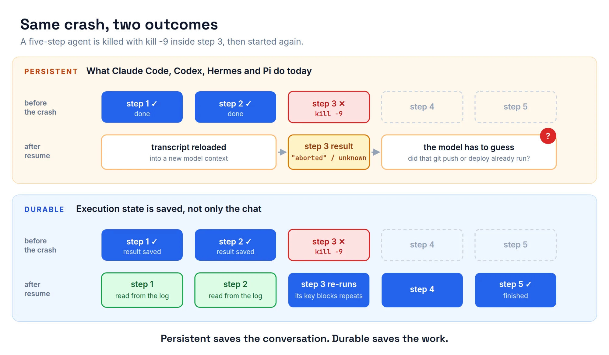

*This is Part 1 of a three-part series we're writing alongside our Nov 14, 2026 session **Beyond the Harness: Engineering Durable AI Agents**. Part 2 is the hands-on fix in LangGraph. Part 3 compares the durable-execution stacks and ends with a checklist.*

## The 47-of-50 problem

Your agent has been running for forty minutes and is on step 47 of 50. It has read the repo, written a plan, edited six files and opened a branch. Then the laptop sleeps, the container is evicted or someone hits Ctrl+C.

What happens next depends on a word most of us use loosely: **durable**.

A lot of agent tooling says it can "resume", and it can, in a narrow sense. This post is about how narrow that is.

## Persistent vs durable



Persistent means the agent saves *the conversation*. After a restart you can reload the transcript and the model reads what happened.

Durable means the agent saves *the work*. After a crash it carries on from the exact step it was on, never runs a side-effecting tool twice, can wait days for a human and leaves an audit trail.

The first is about memory. The second is about *execution*. Nearly every harness we use today does the first.

## What your harness actually saves

Before the session we went through the docs and source code of four popular coding-agent harnesses to see what they save and what "resume" actually does.

|  | Claude Code | OpenAI Codex CLI | Hermes Agent (Nous) | Pi |
| --- | --- | --- | --- | --- |
| Transcript | JSONL in `~/.claude/projects/` | JSONL rollouts in `~/.codex/sessions/` | SQLite `~/.hermes/state.db` | JSONL tree in `~/.pi/agent/sessions/` |
| Resume | `claude --continue` / `--resume` | `codex resume --last` | `hermes -c` | `pi --continue` |
| File undo | `/rewind` (file-edit tools only, not Bash) | `thread/revert` rewrites history only | Opt-in shadow git, `/rollback` | None built in |
| A tool call cut off by a crash | Not re-run on resume | Replaced with a fake "aborted" result | Read-only: dropped. Side-effecting: kept and marked *"effect is UNKNOWN"* | Fake "No result provided" error |
| Execution resumed? | No | No | No | No (yes in the separate `pi-durable` package) |

All four are persistent. None is durable. "Resume" loads the saved transcript into a new model context. None of them continues a half-finished step, and none removes duplicate side effects. The model has to guess whether that `git push` or deploy already happened.

Anthropic says so directly in the Agent SDK docs: sessions persist *"the conversation, not the filesystem."*

A few details stood out to us. Hermes is the most honest of the four. It separates read-only interrupted calls from side-effecting ones and stores the outcome as `unknown`. A turn lost in a gateway crash blocks the session until a human discards it.

Pi ships a real durable harness as a separate library, `@earendil-works/pi-durable` (v1.0, Oct 2026). It saves a tool call's intent *before* running it, re-runs after a crash only tools marked `replay: "safe"`, and has a crash-loop limit.

And Temporal ran Pi on Temporal ("The immortal life of Pi", Oct 2026). The demo kills the active worker every 15–40 seconds and the task carries on from another worker. Pi's session file keeps the conversation; Temporal keeps the execution.

One Pi user on Reddit summed it up: *"Base Pi already saves your sessions and tool history. The difference is Pi Durable also tracks the execution state."*

## Two failures you can reproduce in a minute

We built small scripts (no LLM, no API key) that start an agent-like graph, kill it with `SIGKILL` (no cleanup, no `finally`), and start a new process on the same thread. Part 2 has the code; here's what happened.

### Failure 1: finished work is lost

A five-node LangGraph graph with a SQLite checkpointer, using LangGraph's **default** durability mode. We killed it inside node 3:

```text
== process 1: run (will be killed in n3)
  running n1  (done so far: [])
  running n2  (done so far: ['n1'])
  running n3  (done so far: ['n1', 'n2'])
  SIGKILL inside n3
== process 2: resume same thread_id
  saved state: done=[] next=('__start__',)
  running n1  (done so far: [])
  running n2  (done so far: ['n1'])
  ...
```

`done=[]`. The two finished nodes had not been written to disk before the kill, so they ran again. In a real agent those are paid LLM calls, and a second run of an LLM call can give a different answer.

### Failure 2: the tool runs twice

A `plan → charge → report` graph. `charge` pays, and then the process dies *before* the checkpoint records it. On resume the node runs again:

```text
== naive: payments made = 2
```

Two payments. A persistent checkpointer doesn't help here: it guarantees the node *will* run again, which is exactly the problem.

## The four guarantees

Those two failures give us the definition we'll use for the rest of the series. A durable agent makes four guarantees:

| \# | Guarantee | What breaks without it |
| --- | --- | --- |
| 1 | **Crash mid-task → resume from the exact step** | Finished LLM calls are paid for and re-run, possibly with different answers |
| 2 | **A tool that already ran never runs twice** | Double payments, double deploys, two PRs |
| 3 | **A pending approval can wait days** | The pause lives in RAM, and a restart forgets it |
| 4 | **Every step is recorded and auditable** | "Who approved this diff?" has no answer |

Five ideas make those guarantees possible:

1. Workflow vs step. The agent loop (workflow) must be deterministic. Anything non-deterministic or with a side effect, including the LLM call, every tool, HTTP requests and the clock, is a *step*: run once, record the result, and on replay return the recorded result.
2. Deterministic replay. No `time.time()`, `random` or network I/O inside the workflow body. Use the engine's versions.
3. At-least-once + idempotency key = effectively once. Engines retry a step until they record success, so a step can run twice. The downstream call must dedupe on a key built from durable ids, for example `f"{workflow_id}:{tool_call_id}"`.
4. The outbox pattern. Commit the business change and a record of it in one transaction. Durable execution engines generalise this: their log is the outbox for every step.
5. When you cannot know. Some providers ignore idempotency keys. A missing result is then *unknown*, not *failed*: park the run and reconcile it, and don't retry blindly.

## What's next

In **Part 2** we fix each failure in LangGraph, using last session's coding agent. It's one line for crash recovery, one swap for approvals that survive a restart, and a ledger for exactly-once tools. We also cover the key-generation mistake that quietly brings the double payment back.

Come to the session on **Sat, Nov 14, 9:00 AM at LSEG Hyderabad** with a laptop. We'll kill agents live.
