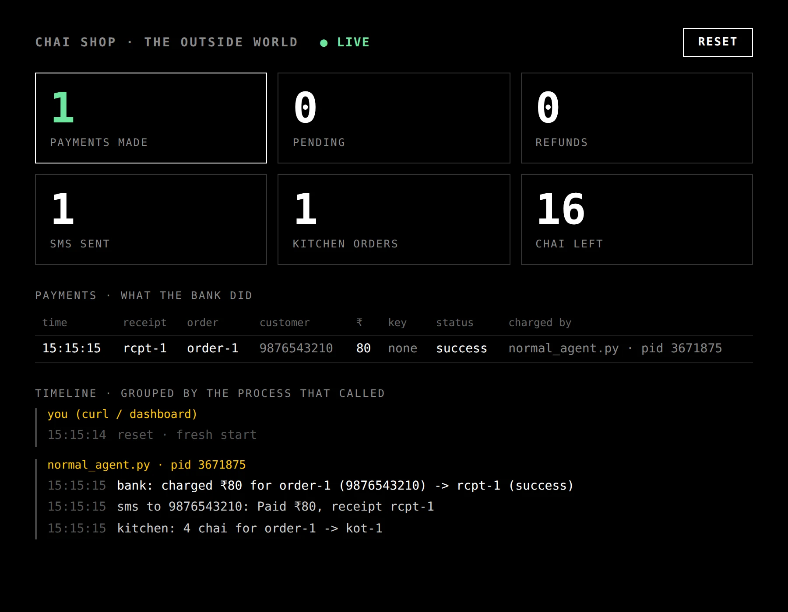
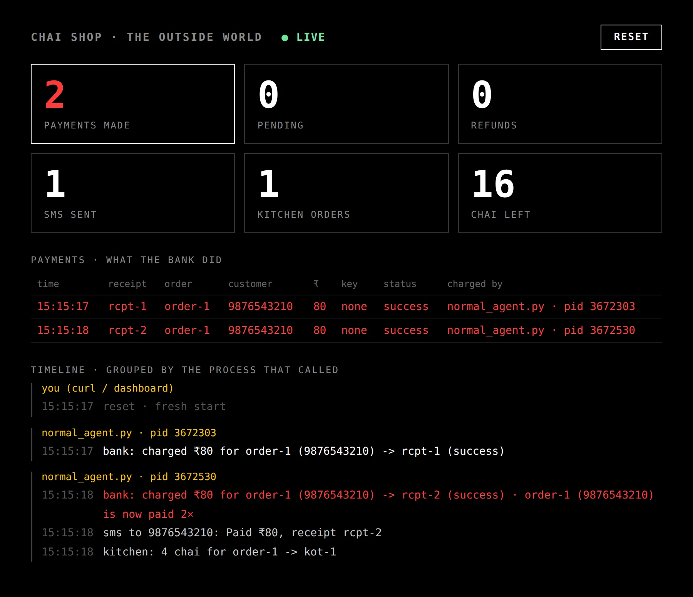

*Written alongside our session on durable AI agents at LSEG Hyderabad on November 14. Every command here is shown for macOS / Linux and for Windows, so you can follow along on your own laptop.*

A customer sends a message: *"4 chai for 98765 43210"*. An agent reads it, charges ₹80 over UPI, texts a receipt and tells the kitchen to make four chai.

That's the whole agent. It works. Then the process dies one second after the charge, and when it comes back the customer pays again.

This series is about that second. In this post we build the agent and break it. [Part 2](/blog/beyond-the-harness-part-2-four-guarantees-tested-with-kill-9-in-langgraph) makes it durable, and [part 3](/blog/beyond-the-harness-part-3-the-chai-agent-on-temporal) runs it on Temporal so that nobody even has to restart it.

All the code is here: **https://github.com/been-there-done-that/durable-ai-agents**

## What you need

- [git](https://git-scm.com/downloads) and [uv](https://docs.astral.sh/uv/). uv installs the right Python (3.12+) for you.
- Three terminal windows
- Ten minutes

No API key is needed. The LLM step can run in mock mode (`MOCK_LLM=1`), which also makes every crash repeatable. If you want a real model, any OpenAI-compatible endpoint works; NVIDIA's free endpoint is the default (`LLM_API_KEY=nvapi-...`).

Every command in this series is shown twice where it differs: once for **macOS / Linux** (bash or zsh), once for **Windows (PowerShell)**. On Windows, use PowerShell, ideally inside [Windows Terminal](https://aka.ms/terminal), not the old `cmd.exe`. If you use WSL, follow the macOS / Linux commands.

Install uv:

**macOS / Linux**

```bash
curl -LsSf https://astral.sh/uv/install.sh | sh
```

**Windows (PowerShell)**

```powershell
powershell -ExecutionPolicy ByPass -c "irm https://astral.sh/uv/install.ps1 | iex"
```

Then **close the terminal and open a new one**, so it finds `uv`. Check with `uv --version`.

Get the code (the same on every OS):

```bash
git clone https://github.com/been-there-done-that/durable-ai-agents
cd durable-ai-agents
uv sync
```

## The outside world

An agent is only interesting when it *does* something, and the things worth doing (charging money, sending messages, placing orders) happen in someone else's system. So the repo comes with a fake outside world, `shop_mock.py`: a UPI bank, an SMS gateway and a kitchen with 20 chai in stock.

In terminal 1 (the same on every OS):

```bash
uv run python shop_mock.py
```

Leave it running and open **http://localhost:8099**. The dashboard counts everything the agent does to the world. The number to watch all series long is **payments made**. For one order it must be 1.



## The agent

We build it with [LangGraph](https://langchain-ai.github.io/langgraph/), because an agent is a loop of steps with some state passed between them, and LangGraph makes those steps explicit. That will matter in part 2: you can only resume from "the exact step" if your code *has* steps.

The whole agent is [`normal_agent.py`](https://github.com/been-there-done-that/durable-ai-agents/blob/main/normal_agent.py). It's 70 lines.

### The state

Everything the agent knows about this order:

```python
class State(TypedDict, total=False):
    text: str      # the customer's message
    phone: str
    qty: int
    receipt: str   # from the bank
    kitchen: str   # the kitchen ticket
```

### The four steps

Each step is a function that takes the state and returns what changed.

**1. Read the order.** The LLM turns free text into structured data:

```python
def read_order(state: State) -> dict:
    order = llm_read_order(state["text"])     # -> {"phone": "9876543210", "qty": 4}
    say(f"read_order: {order['qty']} chai for {order['phone']}")
    return order
```

`llm_read_order` (in [`common.py`](https://github.com/been-there-done-that/durable-ai-agents/blob/main/common.py)) sends one prompt, *"Extract the order. Reply with JSON only"*, and parses the answer. In mock mode it uses a regex instead.

**2. Charge the customer.** This is the step that touches money:

```python
def charge_upi(state: State) -> dict:
    amount = state["qty"] * PRICE
    banner(f"about to charge ₹{amount}")
    r = shop("/pay", {"order_id": "order-1", "amount": amount})
    say(f"charge_upi: ₹{amount} -> {r['receipt']}")
    banner(f"charged ₹{amount} · moving on")
    return {"receipt": r["receipt"]}
```

`banner()` prints a line and, if you set `DEMO_PAUSE=8`, waits 8 seconds. That's your window to kill the process.

**3 and 4. Text the receipt, send the order to the kitchen:**

```python
def send_receipt(state: State) -> dict:
    shop("/sms", {"to": state["phone"], "text": f"Paid ₹{state['qty'] * PRICE}, receipt {state['receipt']}"})
    return {}


def send_to_kitchen(state: State) -> dict:
    r = shop("/kitchen", {"order_id": "order-1", "qty": state["qty"]})
    return {"kitchen": r.get("ticket", "sold out")}
```

### Wiring it up

```python
def build(checkpointer):
    g = StateGraph(State)
    for node in (read_order, charge_upi, send_receipt, send_to_kitchen):
        g.add_node(node)
    g.add_edge(START, "read_order")
    g.add_edge("read_order", "charge_upi")
    g.add_edge("charge_upi", "send_receipt")
    g.add_edge("send_receipt", "send_to_kitchen")
    g.add_edge("send_to_kitchen", END)
    return g.compile(checkpointer=checkpointer)


graph = build(InMemorySaver())
graph.invoke({"text": ORDER}, {"configurable": {"thread_id": "order-1"}})
```

```
read_order ──> charge_upi(₹80) ──> send_receipt ──> send_to_kitchen
   (LLM)          (bank)              (SMS)            (kitchen)
```

Note the `InMemorySaver()`. LangGraph saves the state after every step, and this one saves it to memory. Keep an eye on it.

## Run it

In terminal 2:

**macOS / Linux**

```bash
MOCK_LLM=1 uv run python normal_agent.py
```

**Windows (PowerShell)**

```powershell
$env:MOCK_LLM="1"
uv run python normal_agent.py
```

> **Windows:** `NAME=value command` is bash syntax and doesn't work in PowerShell. There you set `$env:NAME="value"` first, and it **stays set for that window** until you close it. So in the same window you only set it once. To unset one: `Remove-Item Env:NAME`.

```
[pid 2651475] starting fresh
[pid 2651475] LLM call: read_order('4 chai for 98765 43210')
[pid 2651475] read_order: 4 chai for 9876543210
[pid 2651475] ▶ about to charge ₹80
[pid 2651475] charge_upi: ₹80 -> rcpt-1
[pid 2651475] ▶ charged ₹80 · moving on
[pid 2651475] send_receipt: sms sent
[pid 2651475] send_to_kitchen: kot-1
[pid 2651475] done · payments made 1 · kitchen kot-1
```

One payment, one SMS, one kitchen ticket. Ship it?

## Now kill it

Click **reset** on the dashboard. Run it again, this time with the pause:

**macOS / Linux**

```bash
MOCK_LLM=1 DEMO_PAUSE=8 uv run python normal_agent.py
```

**Windows (PowerShell)**

```powershell
$env:MOCK_LLM="1"; $env:DEMO_PAUSE="8"
uv run python normal_agent.py
```

When it prints `▶ charged ₹80 · moving on · 8s to kill me…`, kill it from terminal 3. You have 8 seconds:

**macOS / Linux**

```bash
pkill -9 -f normal_agent.py
```

**Windows (PowerShell)**

```powershell
Get-CimInstance Win32_Process -Filter "CommandLine LIKE '%normal_agent.py%'" | ForEach-Object { Stop-Process -Id $_.ProcessId -Force }
```

Both find the process by its command line and kill it on the spot. On Windows, `Stop-Process -Force` is the equivalent of `kill -9`. If the one-liner is too much to type in 8 seconds, every line the agent prints starts with its process id, `[pid 12345]`, so `taskkill /F /PID 12345` works too, and so does a bigger `DEMO_PAUSE`.

`kill -9` is a crash, not a shutdown. The process gets no warning and no chance to clean up or save anything. It's what happens when a container runs out of memory, a node is drained, a laptop lid closes or a deploy replaces the pod. Ctrl+C is the polite version, and real failures are rarely polite.

The money has left the customer's account. The receipt never went out, and the kitchen never heard about the order. The customer is waiting.

So we do what anyone would do: run it again, in terminal 2.

**macOS / Linux**

```bash
MOCK_LLM=1 DEMO_PAUSE=8 uv run python normal_agent.py
```

**Windows (PowerShell)** (the variables are still set in this window)

```powershell
uv run python normal_agent.py
```

```
[pid 2651475] starting fresh
[pid 2651475] LLM call: read_order('4 chai for 98765 43210')
[pid 2651475] read_order: 4 chai for 9876543210
[pid 2651475] ▶ about to charge ₹80
[pid 2651475] charge_upi: ₹80 -> rcpt-2
...
[pid 2651475] done · payments made 2 · kitchen kot-1
```

(The pid is different on your machine, and it changes with every run.)

`starting fresh`. It read the order again, which is a second LLM call you pay for, and then **charged the customer again**: `rcpt-2`. The dashboard shows both payments in red, each from a different process.



## Why

Everything the agent knew lived in RAM: the parsed order, the fact that `charge_upi` had finished, the receipt. `kill -9` threw all of it away. The new process had no idea an earlier one existed, so it did the only thing it could, which was to start from the top.

Starting from the top is fine for a step like `read_order`, which only costs money and time. It's *not* fine for `charge_upi`, because that step changed something in someone else's system, and that change didn't die with our process.

That's the difference between two kinds of steps:

| Step | Run it twice and… |
|---|---|
| `read_order` (LLM) | you pay for tokens twice. Annoying. |
| `charge_upi` (bank) | the customer pays twice. A support ticket, a refund and a lost customer. |
| `send_receipt` (SMS) | the customer gets two texts. Confusing. |
| `send_to_kitchen` | four extra chai nobody paid for. |

## "But my agent framework saves the conversation"

Most agent harnesses (coding agents, chat frameworks) do save the chat history: you can close the window and pick the conversation up again. That's **persistence**. It saves *what was said*.

What we need is **durability**: saving *what was done*, step by step, so that after a crash the agent continues from the exact step instead of starting over, and never repeats something the world already saw.

A saved conversation that ends with *"I'll charge the customer now"* doesn't tell you whether the charge happened.

## What a durable agent has to promise

1. **Resume from the exact step.** After a crash, continue where it stopped, not from the top.
2. **Side effects happen once.** A charge that went through is never sent again.
3. **Wait for a person.** Some steps need a human (a bank confirming, a customer choosing, an admin approving), and that wait can take hours. The wait has to survive restarts too.
4. **Write every step down.** When the customer calls asking *"where's my money?"*, you can answer.

In [part 2](/blog/beyond-the-harness-part-2-four-guarantees-tested-with-kill-9-in-langgraph) we add all four to this agent, in one file. The kill test stays the same, and the result changes: **payments made: 1**.

## If something goes wrong

**`uv: command not found`, or `uv` "is not recognized"**
The installer added uv to your PATH, but only new terminals see it. Close the terminal and open a new one. On Windows, if the install script is blocked, check that you copied the whole `powershell -ExecutionPolicy ByPass ...` line.

**`uv sync` hangs or fails to download**
You're probably behind a company proxy. Set it first: `export HTTPS_PROXY=http://proxy:port` (macOS / Linux) or `$env:HTTPS_PROXY="http://proxy:port"` (Windows), or try a different network.

**`can't reach the shop at http://127.0.0.1:8099`**
The shop isn't running. Start `uv run python shop_mock.py` in terminal 1 and leave it open. All three terminals must be on the same machine: on Windows, don't run the shop in WSL and the agent in PowerShell, or the other way round.

**`[shop] can't use port 8099`**
Something else is using the port, often an old shop you forgot in another window. Close it, or use another port in **both** terminals:

```bash
PORT=8199 uv run python shop_mock.py                                       # macOS / Linux, terminal 1
SHOP_URL=http://127.0.0.1:8199 MOCK_LLM=1 uv run python normal_agent.py    # terminal 2
```

```powershell
$env:PORT="8199"; uv run python shop_mock.py                               # Windows, terminal 1
$env:SHOP_URL="http://127.0.0.1:8199"; uv run python normal_agent.py       # terminal 2
```

On Windows, Hyper-V and WSL reserve some port ranges, and the error is `WinError 10013`. The same fix works.

**The dashboard shows numbers from an earlier run**
Click **reset** before each experiment. Restarting the shop also starts it from zero.

**It finished before I could kill it**
`DEMO_PAUSE=8` wasn't set for that run. On macOS / Linux it goes on the same line as the command. On Windows, check it with `$env:DEMO_PAUSE`; if you opened a new window, set it again.

**I killed it, but the dashboard shows 0 payments**
You killed it before the charge. Wait for the line that says `▶ charged ₹80 · moving on · 8s to kill me…`, then kill it.

**I pressed Ctrl+C instead**
Ctrl+C is a polite stop, and you'll see a `KeyboardInterrupt` traceback. It shows the same double charge here, but use the kill command to see a real crash.

**`LLM_API_KEY is not set`**
You left out `MOCK_LLM=1`, so it tried to call a real LLM. Add `MOCK_LLM=1`, or set `LLM_API_KEY` to your key.

**Odd characters like `₹` instead of `₹` (Windows)**
That's an old console font or code page. Use Windows Terminal. The scripts already print UTF-8.

**Windows Firewall asks about Python**
The shop only listens on your own machine (`127.0.0.1`), so you can click **Cancel**.

---

*This series accompanies the AI Yatra session "Durable AI Agents" at LSEG Hyderabad, 14 Nov 2026. Code: [been-there-done-that/durable-ai-agents](https://github.com/been-there-done-that/durable-ai-agents).*
