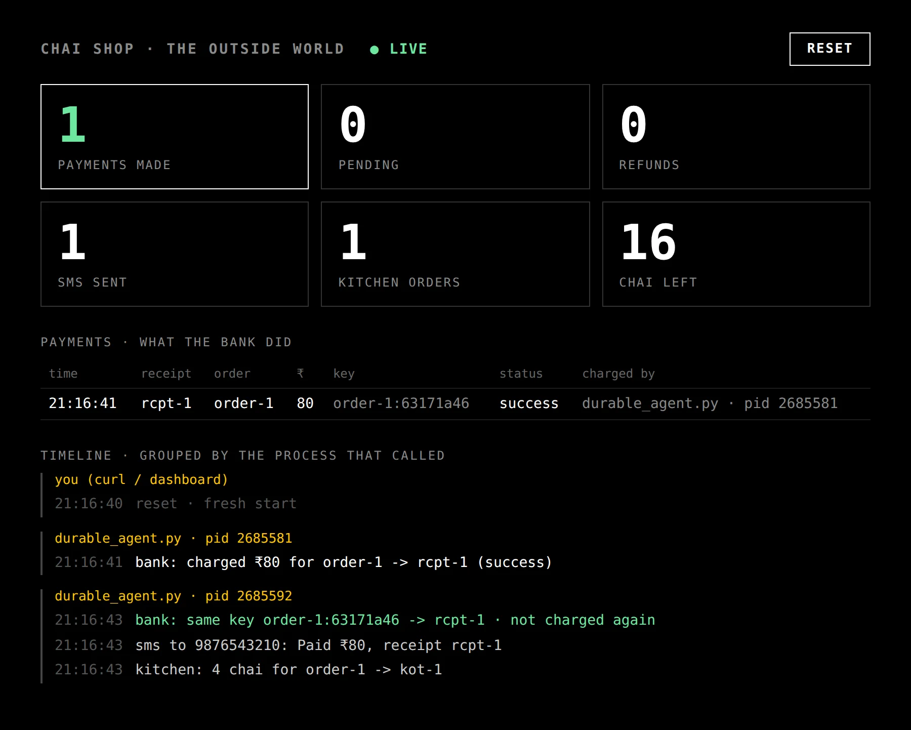

*Written alongside our session on durable AI agents at LSEG Hyderabad on November 14. Every command here is shown for macOS / Linux and for Windows, so you can follow along on your own laptop.*

In [part 1](/blog/beyond-the-harness-part-1-persistent-is-not-durable) we built a chai ordering agent, killed it one second after it charged the customer, ran it again, and watched it charge the customer a second time.

In this post we fix it. The result is [`durable_agent.py`](https://github.com/been-there-done-that/durable-ai-agents/blob/main/durable_agent.py): the same agent with four fixes, one for each promise from part 1.

| Promise | Fix |
|---|---|
| Resume from the exact step | checkpoints on disk, written before the next step starts |
| Side effects happen once | an idempotency key, made once and saved |
| Wait for a person | `interrupt()`: a saved pause |
| Write every step down | the checkpoint history |

Code: **https://github.com/been-there-done-that/durable-ai-agents**. Keep the shop running from part 1 (`uv run python shop_mock.py`) with the dashboard open at http://localhost:8099.

As in part 1, commands that differ are shown for **macOS / Linux** and for **Windows (PowerShell)**. In PowerShell, `$env:NAME="value"` stays set for the whole window, which matters for one of the experiments below.

## Fix 1: save every step to disk

The normal agent saved its state after every step, to memory:

```python
graph = build(InMemorySaver())
```

The durable one saves it to a SQLite file:

```python
from langgraph.checkpoint.sqlite import SqliteSaver

def saver() -> SqliteSaver:
    return SqliteSaver(sqlite3.connect("durable.db", check_same_thread=False))
```

There's one more setting, and it's the one people miss:

```python
graph.invoke(value, config, durability="sync")
```

LangGraph's default is `"async"`: the checkpoint is written in the background *while the next step already runs*. That's faster, and a `kill -9` at the wrong moment loses the last step. `"sync"` writes each checkpoint to disk **before** the next step starts. For steps that touch money, that's the one you want.

Now, when the agent starts, it can ask whether there's a saved run for this order:

```python
snap = graph.get_state(config)
if snap.next:                                   # a saved run that didn't finish
    say(f"found a saved run · resuming at {list(snap.next)}")
    graph.invoke(None, config, durability="sync")   # None = carry on from the checkpoint
elif snap.values:
    say("already finished · nothing to do")
else:
    graph.invoke({"text": ORDER}, config, durability="sync")
```

The `thread_id` in the config (`order-1`) is the key to all of this. One order, one thread, one saved history.

### Is that enough?

Kill it after the charge, the same as in part 1, and look at what the second run does with fix 1 alone:

```
found a saved run · resuming at ['charge_upi']
▶ about to charge ₹80
charge_upi: ₹80 -> rcpt-2
```

There's good news and bad news:

- **Good:** no `LLM call` line. `read_order` finished before the crash, its result was on disk, and it came back for free.
- **Bad:** it **still charged twice**.

The reason: a checkpoint is saved *after* a step finishes. `charge_upi` was killed halfway, after the bank charged but before the step returned, so as far as LangGraph knows it never ran. On resume it runs again, and the bank sees what looks like a brand-new payment.

This is true of every durable system, Temporal included: **a step that dies in the middle runs again.** That's called *at-least-once*. You can't checkpoint your way out of it, because there will always be a gap between "the bank did it" and "we wrote it down". What you can do is make running it again harmless.

## Fix 2: charge once, with an idempotency key

An idempotency key is a unique id you send with a request. The bank remembers it: if the same key comes in twice, it returns the original result instead of charging again. Many payment APIs support this; Stripe's `Idempotency-Key` header is the best-known example.

The trick is *where you make the key*. It has to be made **once**, and saved **before** the charge:

```python
def read_order(state: State) -> dict:
    order = llm_read_order(state["text"])
    # the payment key is made here, once, and saved with this step
    return {**order, "pay_key": f"{ORDER_ID}:{uuid.uuid4().hex[:8]}"}


def charge_upi(state: State) -> dict:
    amount = state["qty"] * PRICE
    key = state["pay_key"]                      # the saved key, the same on every re-run
    r = shop("/pay", {"order_id": ORDER_ID, "amount": amount, "key": key})
    ...
```

Because `read_order` finished and was checkpointed, the key is on disk. When `charge_upi` re-runs, it sends the same key.

Click **reset**, then run it, kill it during `charged ₹80 · 8s to kill me…`, and run it again:

**macOS / Linux**

```bash
MOCK_LLM=1 DEMO_PAUSE=8 uv run python durable_agent.py     # terminal 2
pkill -9 -f durable_agent.py                               # terminal 3, during the countdown
MOCK_LLM=1 DEMO_PAUSE=8 uv run python durable_agent.py     # terminal 2 again
```

**Windows (PowerShell)**

```powershell
# terminal 2
$env:MOCK_LLM="1"; $env:DEMO_PAUSE="8"
uv run python durable_agent.py

# terminal 3, during the countdown
Get-CimInstance Win32_Process -Filter "CommandLine LIKE '%durable_agent.py%'" | ForEach-Object { Stop-Process -Id $_.ProcessId -Force }

# terminal 2 again
uv run python durable_agent.py
```

First run:

```
[pid 2651486] starting fresh · order-1
[pid 2651486] LLM call: read_order('4 chai for 98765 43210')
[pid 2651486] read_order: 4 chai for 9876543210
[pid 2651486] ▶ about to charge ₹80 · key order-1:b2308cd3
[pid 2651486] charge_upi: ₹80 -> rcpt-1 (success)
Killed
```

(`Killed` is what bash prints. PowerShell prints nothing; the output just stops.)

Second run:

```
[pid 2651491] found a saved run · resuming at ['charge_upi'] · done so far: ['pay_key', 'phone', 'qty']
[pid 2651491] ▶ about to charge ₹80 · key order-1:b2308cd3
[pid 2651491] charge_upi: ₹80 -> rcpt-1 (success)  · bank: same key, not charged again
[pid 2651491] check_payment: rcpt-1 is success
[pid 2651491] check_stock: 20 chai left, need 4
[pid 2651491] send_receipt: sms sent
[pid 2651491] send_to_kitchen: kot-1
[pid 2651491] done · payment success · kitchen kot-1 · refund - · payments made 1
```

Same key, same receipt, **payments made: 1.**



### The trap

It's tempting to make the key right where you use it:

```python
def charge_upi(state: State) -> dict:
    key = f"{ORDER_ID}:{uuid.uuid4().hex[:8]}"    # looks fine, isn't
```

Try it. The repo has a switch for exactly this mistake. First delete the saved order (otherwise the agent says `order-1 already finished`) and reset the dashboard:

**macOS / Linux**

```bash
rm -f durable.db
MOCK_LLM=1 DEMO_PAUSE=8 KEY_FROM=node uv run python durable_agent.py
pkill -9 -f durable_agent.py                     # terminal 3, during the countdown
MOCK_LLM=1 DEMO_PAUSE=8 KEY_FROM=node uv run python durable_agent.py
```

**Windows (PowerShell)**

```powershell
Remove-Item durable.db -ErrorAction SilentlyContinue
$env:MOCK_LLM="1"; $env:DEMO_PAUSE="8"; $env:KEY_FROM="node"
uv run python durable_agent.py

# terminal 3, during the countdown
Get-CimInstance Win32_Process -Filter "CommandLine LIKE '%durable_agent.py%'" | ForEach-Object { Stop-Process -Id $_.ProcessId -Force }

# terminal 2 again
uv run python durable_agent.py

# done with the trap: switch it off, or every later run in this window pays twice
Remove-Item Env:KEY_FROM
```

```
▶ about to charge ₹80 · key order-1:f95c5482
charge_upi: ₹80 -> rcpt-1 (success)
Killed
found a saved run · resuming at ['charge_upi']
▶ about to charge ₹80 · key order-1:b0b23080
charge_upi: ₹80 -> rcpt-2 (success)
done · ... · payments made 2
```

A new key on every re-run looks like a new payment to the bank. An idempotency key only works if it survives the crash, so make it in an *earlier* step that has already been saved.

The same goes for every other side effect. The SMS and the kitchen order carry keys too (`order-1:sms:receipt`, `order-1:kitchen`), so a re-run never sends a second text or a second ticket.

## Fix 3: when you can't know yet, wait

Fixes 1 and 2 cover the clean crash. Real life is messier. Here's the case we'll handle:

> The customer pays. The agent crashes. Two minutes later it's back, and two things have changed:
> 1. The payment is **pending**: the money left the customer's account but hasn't reached the shop. (Anyone who has used UPI has seen this. The bank settles it later: success, or reversed.)
> 2. The chai is **sold out**.

What should the agent do?

- **Retry the charge?** No. That's a second payment.
- **Refund?** Not yet. If you refund now and the bank later reverses the pending payment, the customer gets ₹160 back for an ₹80 order. A refund can't be undone, so never refund money you don't have yet.
- **Wait for the bank.** Yes. Then, once the money is really ours, **ask the customer** what they want.

The tricky part is that the wait can take minutes, hours, or until the next day. You can't hold a process open that long, and if you do, it will crash. The wait has to be **saved**, like every other step.

LangGraph's tool for this is `interrupt()`. It pauses the graph, saves the pause in the checkpoint, and returns control to you. Later, possibly from a different process on a different day, you resume it with an answer.

```python
def check_payment(state: State) -> dict:
    status = shop(f"/payment?receipt={state['receipt']}")["status"]
    if status == "pending":
        # not "retry" (a new payment) and not "failed" (the money may still land): wait
        interrupt({"waiting_for": "bank", "receipt": state["receipt"]})
        status = shop(f"/payment?receipt={state['receipt']}")["status"]   # the bank is the truth
    return {"payment": status}
```

One rule: **when you resume, the step runs again from the top**, and the `interrupt()` call returns the answer instead of pausing. So anything above `interrupt()` must be safe to run twice. Here it only reads.

The customer gets the same treatment:

```python
def ask_customer(state: State) -> dict:
    shop("/sms", {"to": state["phone"], "text": "Sorry, chai's sold out. Reply WAIT (10 min), COFFEE or REFUND.",
                  "key": f"{ORDER_ID}:sms:ask"})          # keyed: re-running sends nothing new
    choice = interrupt({"waiting_for": "customer", "options": ["wait", "coffee", "refund"],
                        "deadline": time.time() + CUSTOMER_TIMEOUT})
    return {"choice": choice}
```

Every wait needs a **deadline and a safe default**. If the customer doesn't answer in 2 hours, we refund: giving the money back is the safe choice.

The refund itself can't be undone either, so it runs once (with its own key). Small refunds are automatic; above ₹2,000 an admin approves, and the agent waits for them, for days if it has to:

```python
def refund(state: State) -> dict:
    amount = state["qty"] * PRICE
    if amount > REFUND_AUTO_LIMIT:
        if interrupt({"waiting_for": "admin", "refund": amount}) != "approve":
            return {"refund": "rejected"}
    r = shop("/refund", {"receipt": state["receipt"], "key": f"{ORDER_ID}:refund"})   # once, even if re-run
    ...
```

Here's the full graph:

```
read_order -> charge_upi -> check_payment --pending--> (wait for the bank)
                                |--reversed--> tell_customer                (no money taken)
                                '--success---> check_stock --in stock--> send_receipt -> send_to_kitchen
                                                   '--sold out--> ask_customer (wait for the customer)
                                                                     |-- wait   -> check_stock
                                                                     |-- coffee -> send_receipt -> send_to_kitchen
                                                                     '-- refund / no reply -> refund
                                                                                 (above ₹2,000: wait for an admin)
```

### Try it

Reset the dashboard and start fresh. The second line tells the fake bank to leave payments pending (reset switches it off again):

**macOS / Linux**

```bash
rm -f durable.db
curl -X POST http://127.0.0.1:8099/mode -d '{"pending": true}'
MOCK_LLM=1 uv run python durable_agent.py
```

**Windows (PowerShell)**

```powershell
Remove-Item durable.db -ErrorAction SilentlyContinue
Invoke-RestMethod -Method Post http://127.0.0.1:8099/mode -Body '{"pending": true}'
$env:MOCK_LLM="1"; $env:DEMO_PAUSE="0"
uv run python durable_agent.py
```

(`DEMO_PAUSE="0"` turns the countdown off if it's still set in that window. On Windows, use `Invoke-RestMethod`: in Windows PowerShell 5, `curl` is a different command with different options.)
```
starting fresh · order-1
LLM call: read_order('4 chai for 98765 43210')
read_order: 4 chai for 9876543210
▶ about to charge ₹80 · key order-1:a1821aeb
charge_upi: ₹80 -> rcpt-1 (pending)
⏸ paused · waiting for the bank · saved, safe to kill · next: python durable_agent.py bank success|reversed
```

**The process exits.** Nothing is running. The wait lives in `durable.db`. Start it again, as a crash-and-restart would:

```bash
MOCK_LLM=1 uv run python durable_agent.py       # macOS / Linux
uv run python durable_agent.py                  # Windows, same window
```

```
⏸ paused · waiting for the bank · saved, safe to kill · next: python durable_agent.py bank success|reversed
```

It comes back still waiting and charges nothing. Now the chai runs out, and then the bank settles. From here on, the commands are the same on every OS:

```bash
uv run python durable_agent.py stock 0
uv run python durable_agent.py bank success
```

```
check_payment: rcpt-1 is success
check_stock: 0 chai left, need 4
⏸ paused · waiting for the customer · saved, safe to kill · next: python durable_agent.py customer wait|coffee|refund|no-reply
```

The customer wants their money back:

```bash
uv run python durable_agent.py customer refund
```

```
ask_customer: customer said refund
refund: ₹80 -> rf-1
done · payment success · kitchen - · refund rf-1 · payments made 1
```

One payment, one refund, no chai, a happy-enough customer. Other endings to try (each from a reset and a fresh `durable.db`: `rm -f durable.db` on macOS / Linux, `Remove-Item durable.db` on Windows):

- `bank reversed`: no money was taken, so the agent only tells the customer. Nothing to refund.
- `customer coffee`: the order switches to coffee.
- `customer no-reply`: the deadline passed, so it refunds.
- A big order whose ₹4,000 refund waits for `uv run python durable_agent.py admin approve`. Start it with `ORDER="200 chai for 98765 43210" MOCK_LLM=1 uv run python durable_agent.py` (macOS / Linux) or `$env:ORDER="200 chai for 98765 43210"` then `uv run python durable_agent.py` (Windows; `Remove-Item Env:ORDER` afterwards).

Instead of deleting `durable.db`, you can also give each experiment its own order: `ORDER_ID=order-2` (or `$env:ORDER_ID="order-2"`).

## Fix 4: write every step down

When the customer calls on Monday asking *"where's my money?"*, or the auditor asks *"who approved this refund?"*, you need an answer.

You already have one. With a checkpointer, LangGraph keeps **every** checkpoint, not just the last. The history of a thread is an audit log:

```python
def audit(graph, config) -> list[str]:
    history = list(graph.get_state_history(config))[::-1]          # oldest first
    for before, after in zip(history, history[1:]):
        ran = ", ".join(before.next)                                # the step that ran
        changed = {k: v for k, v in after.values.items() if before.values.get(k) != v}
        waited = [i.value for t in before.tasks for i in t.interrupts]   # did it pause?
        ...
```

```bash
uv run python durable_agent.py audit
```

```
Thu 20:47:55  read_order       phone=9876543210, qty=4
Thu 20:47:55  charge_upi       receipt=rcpt-1
Thu 20:48:00  check_payment    ⏸ waited for the bank (0:00:04) · payment=success
Thu 20:48:00  check_stock      in_stock=False
Thu 20:48:02  ask_customer     ⏸ waited for the customer (0:00:02) · choice=refund, item=chai
Thu 20:48:02  refund           refund=rf-1
```

Each step has a time, what changed, and how long each wait took. In real life those waits are hours, not seconds.

One warning: LangGraph can also *replay* from an old checkpoint ("time travel"). Replaying re-runs every later step for real, so without the idempotency keys from fix 2, that's a great way to refund twice.

## The same thing in Docker

`kill -9` on your laptop and `docker kill` on a container are the same crash. The repo has a compose file:

Install [Docker Desktop](https://www.docker.com/products/docker-desktop/) (macOS, Windows) or Docker Engine (Linux), and make sure it's running. Stop the local shop from terminal 1 first, since the container uses the same port.

**macOS / Linux**

```bash
docker compose build
docker compose up -d shop                                # dashboard: http://localhost:8099
AGENT=durable_agent docker compose up chai-agent
docker kill chai-agent                                   # from another terminal, during the countdown
docker start -a chai-agent                               # resumes at charge_upi → payments made 1
```

**Windows (PowerShell)**

```powershell
docker compose build
docker compose up -d shop
$env:AGENT="durable_agent"; docker compose up chai-agent
docker kill chai-agent                                   # from another terminal, during the countdown
docker start -a chai-agent
```

The `docker` commands themselves are the same everywhere. The checkpoints live on a Docker volume, so they outlive the container. To start over: `docker compose run --rm chai-agent rm -f /data/durable.db`.

## What's still missing

Look at what we did after every crash: **we restarted it by hand.**

A checkpoint saves the work, but nothing *notices* that the run died. If the process dies at 3 AM, the order sits half-done until someone comes in at 10. If two people restart it, two processes run the same order.

You could add a restart policy (`restart: unless-stopped`, Kubernetes, systemd). The process would come back, but it wouldn't know *which* orders were half-done. You'd still write the "find stalled runs and resume them" code yourself, along with the locking that stops two processes grabbing the same order.

That's exactly what a **durable execution engine** does. In [part 3](/blog/beyond-the-harness-part-3-the-chai-agent-on-temporal) we run the same chai agent on Temporal: kill the worker, type nothing, and watch the order finish anyway.

## If something goes wrong

Part 1 covers setup problems (uv, the shop, ports). These are the ones specific to the durable agent:

**`order-1 already finished · nothing to do`**
That's the durable agent working: `durable.db` remembers that order-1 is done, and **reset on the dashboard doesn't clear it**. Delete the file (`rm -f durable.db` / `Remove-Item durable.db`) or use a new `ORDER_ID`.

**It resumed an old order I didn't mean to**
Same cause: a half-finished order-1 from an earlier experiment is still in `durable.db`. Delete the file and reset the dashboard to start clean.

**The durable agent paid twice**
- `KEY_FROM=node` is still set. On Windows it stays set in the window: run `Remove-Item Env:KEY_FROM`, or open a new window.
- Or the shop restarted between the two runs. A new shop forgets the keys it has seen (that's the clean slate), so the re-run looks like a new payment. Keep terminal 1 running for the whole experiment.

**It says `⏸ waiting for the bank` every time**
The bank is still in pending mode, and it's waiting for you: run `uv run python durable_agent.py bank success`. Click **reset** on the dashboard to switch pending mode off.

**`nobody is waiting for the customer right now`** (or the bank, or the admin)
The answer came too late, or it's for a different wait. Run `uv run python durable_agent.py` with no arguments to see what the order is waiting for now.

**`database is locked` (SQLite)**
Another copy of the agent is still running in some window, or the folder is synced by OneDrive or Dropbox. Close the other one, and on Windows clone the repo outside OneDrive (for example `C:\code\durable-ai-agents`).

**`docker: command not found`, or "Cannot connect to the Docker daemon"**
Docker Desktop isn't installed or isn't running. Start it and wait until it says it's running. With an old Docker, the command is `docker-compose` (with a dash).

**`docker compose up -d shop` says the port is in use**
The local shop from terminal 1 is still running. Stop it with Ctrl+C.

---

*This series accompanies the AI Yatra session "Durable AI Agents" at LSEG Hyderabad, 14 Nov 2026. Code: [been-there-done-that/durable-ai-agents](https://github.com/been-there-done-that/durable-ai-agents).*
