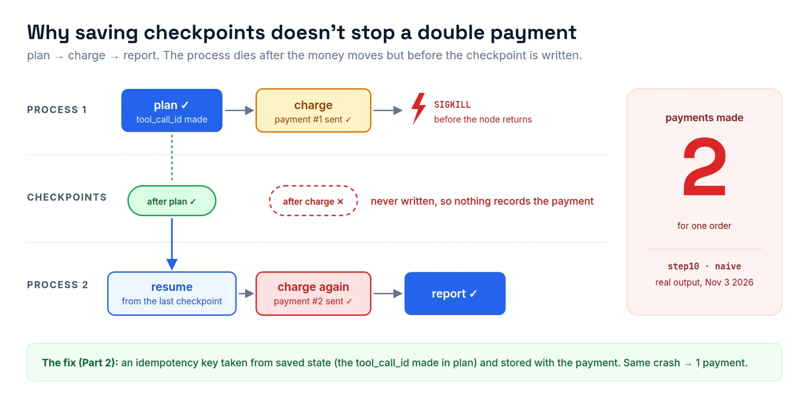

*Part 2 of 3. [Part 1](/blog/beyond-the-harness-part-1-persistent-is-not-durable/) covered why every popular harness is persistent but not durable, and set out four guarantees. This time we test each guarantee in LangGraph by killing the process at the worst possible moment.*

## Setup

Everything below is plain Python with no LLM and no API key, so it behaves the same on every laptop, including whichever ones show up on Saturday. Each script starts a child process, kills it with `SIGKILL`, then starts a new process on the same `thread_id`.

```bash
curl -LsSf https://astral.sh/uv/install.sh | sh
alias lg='uv run --no-project -q --with langgraph==1.2.19 --with langgraph-checkpoint-sqlite==3.1.3 python'
```

On Windows, run these in WSL (`SIGKILL` isn't available on Windows).

## Guarantee 1: resume from the exact step

The first test graph is deliberately boring: five nodes, `n1` to `n5`, with a SQLite checkpointer. Process 1 kills itself inside `n3`. Process 2 calls `graph.invoke(None, config)`, where `None` means "continue this thread from its last checkpoint".

```python
conn = sqlite3.connect("checkpoints.db", check_same_thread=False)
graph = build(SqliteSaver(conn))

graph.invoke({"done": []}, CONFIG, durability="sync")   # process 1, killed in n3
graph.invoke(None, CONFIG, durability="sync")           # process 2, resume
```

With `durability="sync"`:

```text
== process 2: resume same thread_id
  saved state: done=['n1', 'n2'] next=('n3',)
  running n3  (done so far: ['n1', 'n2'])
  running n4 ...
  running n5 ...
  finished: done=['n1', 'n2', 'n3', 'n4', 'n5']
```

It skips `n1` and `n2` and re-runs `n3` from the top. The unit of durability is the node: whatever was running when the process died runs again in full.

### The default is not what you want

LangGraph 1.2 has three durability modes, and the default isn't the safe one. We ran the same kill against each:

| Mode | When it writes | Our SIGKILL test |
| --- | --- | --- |
| `"exit"` | Only when the run ends | No thread at all after the kill |
| `"async"` (default) | In the background while the next step runs | With instant nodes, `n1` and `n2` were lost in 5 of 5 runs |
| `"sync"` | Before the next step starts | Resumed at `n3` every time |

So the rule we work with now: pass `durability="sync"` for any graph whose nodes have side effects or cost money. It costs one checkpoint write per super-step. Cheap, next to losing a run.

## Guarantee 3: an approval that waits days

A quick note on ordering: we're doing guarantee 3 before guarantee 2 here, because it's the simpler fix.

Last session's coding agent asked a human before writing a file, using `interrupt()`. The pause was stored in `InMemorySaver`, so a restart lost it. The fix is a single swap:

```python
from langgraph.checkpoint.sqlite import SqliteSaver   # pip install langgraph-checkpoint-sqlite

with SqliteSaver.from_conn_string("agent_state.db") as saver:
    graph = builder.compile(checkpointer=saver)        # was: InMemorySaver()
    graph.invoke(inputs, config, durability="sync")
```

Process 1 pauses and exits. Process 2 is a fresh Python process started "three days later"; it loads the thread and resumes it:

```text
== process 2: human approves (fresh process, same thread_id)
  loaded thread: next=('approve',)
  pending interrupt value: {'tool': 'write_file', 'path': 'hello.py', ...}
  approve: node body starts (this line re-runs on resume)
  approve: got answer 'approve'
  write: writing hello.py
```

Look at `node body starts` in that output. It prints twice, once when the node pauses and once on resume. In LangGraph's words, *"the runtime restarts the entire node from the beginning"*. So keep everything before `interrupt()` pure, and put the side effect after it.

Two smaller gotchas: a raw `sqlite3.connect()` needs `check_same_thread=False`, and `PostgresSaver` raises `UndefinedTable` until you call `.setup()` once.

## Guarantee 2: a tool that ran must not run twice



This is the one that costs real money. The graph is `plan → charge → report`, and we kill the process after `charge` pays but before the node returns. We tried three versions of `charge`:

- **naive:** insert a payment.
- **ledger:** a ledger table keyed by `(thread_id, tool_call_id)`, written in the *same transaction* as the payment. The key is created in `plan`, so it's saved in the checkpoint.
- **ledger_bad:** the same ledger, but the key is created *inside* `charge`.

```python
def idempotent_pay(db, thread_id, tool_call_id, amount):
    with db:  # effect + ledger row commit together, or neither does
        row = db.execute("select result from ledger where thread_id=? and tool_call_id=?",
                         (thread_id, tool_call_id)).fetchone()
        if row:
            return row[0]                     # already paid: return the saved receipt
        receipt = pay(db, thread_id, amount)
        db.execute("insert into ledger values (?, ?, ?)", (thread_id, tool_call_id, receipt))
    return receipt
```

Results:

```text
== naive:      payments made = 2
== ledger:     ledger hit for 6577613a -> returning saved receipt-3, NOT paying again
               payments made = 1
== ledger_bad: payments made = 2
```

The `ledger_bad` line is the one that matters: the key must come from saved state. A key created inside the node that re-runs is a new key on every run, so the ledger never matches. In a real agent, use the id from `AIMessage.tool_calls[i]["id"]`; it was written in the previous super-step, so it's the same on resume.

When the downstream system is an API rather than your own database, pass the same key as its idempotency key: Stripe's `Idempotency-Key`, `INSERT ... ON CONFLICT DO NOTHING`, or pushing a known git SHA. If the provider has no idempotency support at all, treat a missing result as *unknown* and park the run for reconciliation.

## Guarantee 4: an audit trail you can query

LangGraph keeps every checkpoint, so `get_state_history()` works as an audit log:

```text
step=-1  input  __start__ -> {'path': 'hello.py', 'diff': '', 'decision': ''}
step= 0  loop   propose  -> {'diff': "+ print('hello')"}
step= 1  loop   approve [INTERRUPT 'write_file'] -> {'decision': 'approve'}
step= 2  loop   write    -> {}
step= 3  loop   (end)
```

That answers "who approved what, and what did the tool return?" You can also go back in time: pick the paused checkpoint, edit the diff with `update_state(..., as_node="propose")`, and approve the edited version.

Two traps cost us time here:

1. `invoke(Command(resume="reject"), old_checkpoint)` silently reuses the old answer (`'approve'`), because that answer is stored as a pending write on the checkpoint. The pattern that works: `invoke(None, old_config)` to trigger the interrupt again on a new branch, then resume the thread.
2. Replay is not a cache. Nodes after the chosen checkpoint run again for real, *including their side effects*. That's one more reason to have the ledger from guarantee 2.

## What a checkpointer does not give you

With these four fixes in place, our LangGraph agent survives crashes, waits for humans across restarts and never double-charges. One gap is left, and it matters: nothing restarts a dead run by itself. A checkpointer saves state between steps. It doesn't notice a run has died, restart it, or stop two workers from resuming the same `thread_id` at once. Something has to call `invoke(None, config)`.

That something is what durable-execution engines are for, and they're the subject of Part 3.

## Homework

Take last session's `step06_self_evaluate.py` agent and make it pass three tests:

1. `kill -9` during the evaluate loop resumes without repeating finished LLM calls.
2. An approval left pending overnight resumes in a new process.
3. `write_file` killed after writing does not write twice (ledger keyed on the tool call id).

Bring what you find to the next session.
