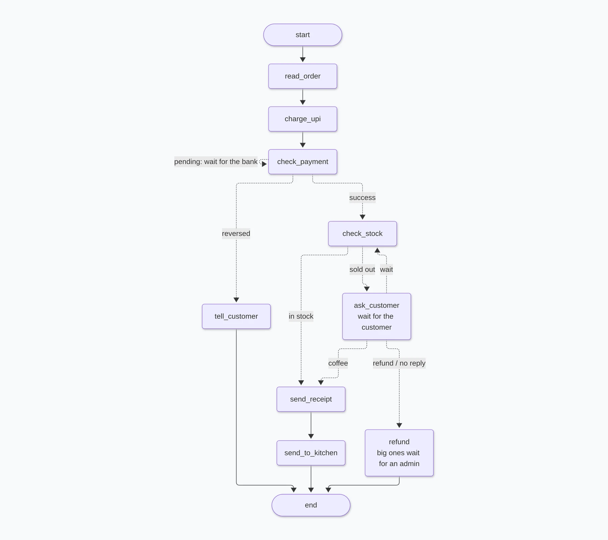
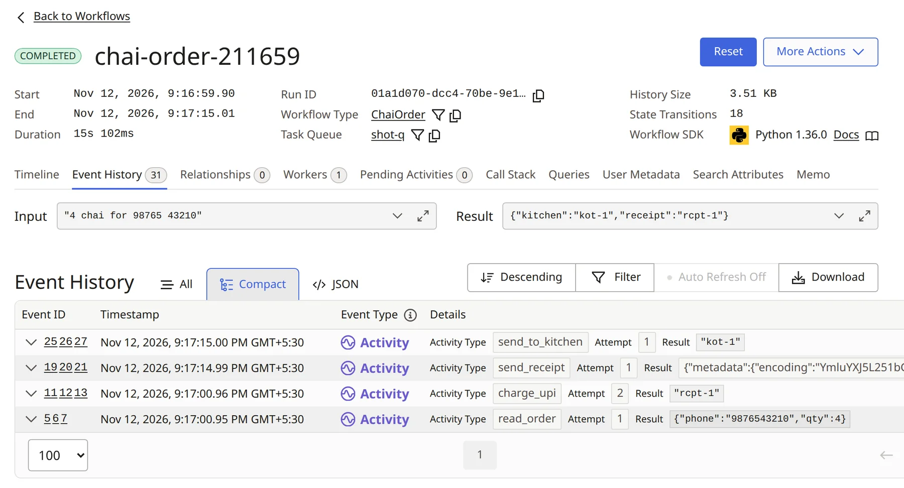
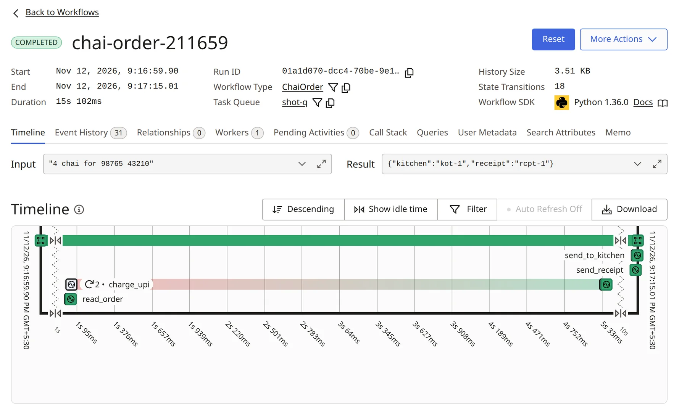

*Written alongside our session on durable AI agents at LSEG Hyderabad on November 14. Every command here is shown for macOS / Linux and for Windows, so you can follow along on your own laptop.*

In [part 2](/blog/beyond-the-harness-part-2-four-guarantees-tested-with-kill-9-in-langgraph) the chai agent became durable. Kill it anywhere, run it again, and it carries on from the exact step and charges the customer once.

But read that again: *run it again.* After every crash, somebody restarted it. Nothing noticed that the run had died. At 3 AM, nobody would.

In this post we run the same agent on [Temporal](https://temporal.io), a durable execution engine. We start two workers, kill the one that's charging the customer, and **don't touch anything**. The other worker finishes the order, and the customer pays once. Then we give it part 2's harder cases (a pending payment, a sold-out kitchen, a big refund) and kill the workers while it waits for people.

It's free and runs on your laptop. No account is needed.

Code: **https://github.com/been-there-done-that/durable-ai-agents**, file [`temporal_agent.py`](https://github.com/been-there-done-that/durable-ai-agents/blob/main/temporal_agent.py).

## Restarting a process isn't the same as finishing the work

There are two ways to make sure "someone" restarts a crashed agent:

| | Examples | What happens after a crash |
|---|---|---|
| **Restart the process** | Docker restart policy, Kubernetes, systemd | The process comes back. It doesn't know which orders were half-done. You write that part. |
| **Durable execution engine** | Temporal, DBOS, Restate, Inngest | The engine keeps the history of every run, notices a dead one, and hands it to a live worker, which carries on from the last finished step. |

We'll use Temporal. The ideas carry over to the others.

## Four words of Temporal

- **Workflow:** the agent loop. It's ordinary code that says what happens in what order. Temporal records each step it takes.
- **Activity:** one step that touches the outside world: the LLM call, the charge, the SMS, the kitchen. Activities can fail and be retried.
- **Worker:** a process that runs your workflows and activities. You can run as many as you like, and any of them can pick up any run.
- **Server:** keeps the **event history** of every workflow ("read_order finished with this result, charge_upi started…"), and hands work to workers.

The event history plays the role the SQLite checkpoints played in part 2. The difference is that the server *watches* it.

## Start the server

Pick one of these. Both are the same on every OS.

**With Docker** (Docker Desktop on macOS and Windows; it uses the compose file in the repo):

```bash
docker compose --profile temporal up -d temporal
```

**Without Docker**, install the [Temporal CLI](https://docs.temporal.io/cli) (`brew install temporal` on macOS; on Linux and Windows, download it from that page) and leave this running in its own terminal:

```bash
temporal server start-dev
```

Give it about 10 seconds, then open **http://localhost:8233**. That's the Temporal UI, where every order's history will show up.

Keep the shop running from part 1 (`uv run python shop_mock.py`, dashboard at http://localhost:8099).

## The code

### Activities: the steps that touch the world

These are the same steps as `durable_agent.py` in part 2, with decorators: `read_order`, `charge_upi`, `check_payment`, `tell_customer`, `check_stock`, `ask_customer`, `send_receipt`, `send_to_kitchen` and `refund`. Three of them:

```python
@activity.defn
async def read_order(text: str) -> dict:
    return llm_read_order(text)


@activity.defn
async def charge_upi(order_id: str, phone: str, amount: int, key: str) -> str:
    r = shop("/pay", {"order_id": order_id, "phone": phone, "amount": amount, "key": key})
    say(f"charge_upi: ₹{amount} -> {r['receipt']} ({r['status']})" + ("  · bank: same key, not charged again" if r["duplicate"] else ""))
    pause = int(os.environ.get("DEMO_PAUSE", "0"))
    for left in range(pause, 0, -1):          # the window to kill this worker
        activity.heartbeat(left)              # "I'm still alive"
        await asyncio.sleep(1)
    return r["receipt"]


@activity.defn
async def send_to_kitchen(order_id: str, qty: int) -> str:
    r = shop("/kitchen", {"order_id": order_id, "qty": qty, "key": f"{order_id}:kitchen"})
    return r.get("ticket", "sold out")
```

The rest are in [`temporal_agent.py`](https://github.com/been-there-done-that/durable-ai-agents/blob/main/temporal_agent.py), and each one that changes something sends a key built from the order id (`order-1:sms:receipt`, `order-1:refund`, …).

Note the **keys** again. Temporal retries an activity that died in the middle, which is the same *at-least-once* problem from part 2. Temporal doesn't make the bank idempotent. You still send a key, and the bank still remembers it.

### How Temporal notices a dead worker

```python
STEP = dict(
    start_to_close_timeout=timedelta(seconds=60),
    heartbeat_timeout=timedelta(seconds=3),        # no heartbeat for 3s → the worker is dead
    retry_policy=RetryPolicy(initial_interval=timedelta(seconds=1)),
)
```

While `charge_upi` runs, it calls `activity.heartbeat()` every second. When a `kill -9` stops the heartbeats, the server waits 3 seconds, marks that attempt as failed, and schedules a retry, which **any** live worker can pick up.

### The workflow: the agent loop

```python
@workflow.run
async def run(self, job: dict) -> dict:
    order_id = workflow.info().workflow_id
    step = workflow.execute_activity

    order = await step(read_order, job["text"], **STEP)
    phone, qty = order["phone"], order["qty"]
    amount = qty * PRICE
    receipt = await step(charge_upi, args=[order_id, phone, amount, f"{order_id}:charge"], **STEP)

    # Payment pending? Not "retry" (a new payment) and not "failed" (the money may still land). Wait.
    payment = await step(check_payment, receipt, **STEP)
    if payment == "pending":
        await self.wait_for("bank", receipt=receipt)
        payment = await step(check_payment, receipt, **STEP)
    if payment == "reversed":
        await step(tell_customer, args=[order_id, phone], **STEP)
        return {"payment": payment, "receipt": receipt}

    # Sold out? Ask the customer. No reply in time counts as "refund".
    item = "chai"
    while not await step(check_stock, qty, **STEP):
        await step(ask_customer, args=[order_id, phone], **STEP)
        choice = await self.wait_for("customer", timeout=timedelta(seconds=job["customer_timeout"]))
        if choice == "wait":
            continue
        if choice == "coffee":
            item = "coffee"
            break
        if amount > job["refund_auto_limit"] and await self.wait_for("admin", refund=amount) != "approve":
            return {"payment": payment, "receipt": receipt, "refund": "rejected"}
        refunded = await step(refund, args=[order_id, phone, amount, receipt], **STEP)
        return {"payment": payment, "receipt": receipt, "refund": refunded}

    await step(send_receipt, args=[order_id, phone, amount, receipt], **STEP)
    kitchen = "coffee" if item == "coffee" else await step(send_to_kitchen, args=[order_id, qty], **STEP)
    return {"payment": payment, "receipt": receipt, "kitchen": kitchen}
```

The happy path is the first four lines, and it reads like the normal agent from part 1. The rest is part 2's branches, written as plain `if` and `while` instead of graph edges.

There's one rule for workflow code: **it must be deterministic.** When a worker picks up a run, it replays the workflow function from the top, and each `execute_activity` that already finished returns its *recorded* result from the history instead of running again. That's how `read_order` (and its LLM call) is never repeated. So no random numbers, clocks, network calls or environment variables directly in the workflow: those belong in activities. That's why the refund limit and the customer's timeout come in with the order (`job`) instead of being read from `os.environ` inside `run`. And the idempotency key is built from the workflow id, which is the same on every replay.

There's no graph object to draw here, since the workflow is plain Python, so `uv run python temporal_agent.py graph` draws a hand-written picture of the same flow:



### Workers and starting an order

```python
async def worker(name: str):
    client = await Client.connect("127.0.0.1:7233")
    w = Worker(client, task_queue="chai", workflows=[ChaiOrder], activities=ACTIVITIES)
    await w.run()


async def start(order_id: str):
    client = await Client.connect("127.0.0.1:7233")
    job = {"text": ORDER, "refund_auto_limit": REFUND_AUTO_LIMIT, "customer_timeout": CUSTOMER_TIMEOUT}
    handle = await client.start_workflow(ChaiOrder.run, job, id=order_id, task_queue="chai")
    await report(handle)   # returns when the order is done, or waiting for somebody
```

The workflow id is the order id. Temporal won't run two live workflows with the same id, so two people "starting" order-1 can't charge twice either.

## Kill it

You need five terminals now: the shop, two workers, one to place the order and one for the kill. Start two workers, each in its own terminal:

**macOS / Linux**

```bash
MOCK_LLM=1 DEMO_PAUSE=8 uv run python temporal_agent.py worker worker-1     # terminal A
MOCK_LLM=1 DEMO_PAUSE=8 uv run python temporal_agent.py worker worker-2     # terminal B
```

**Windows (PowerShell)**

```powershell
# terminal A
$env:MOCK_LLM="1"; $env:DEMO_PAUSE="8"
uv run python temporal_agent.py worker worker-1

# terminal B
$env:MOCK_LLM="1"; $env:DEMO_PAUSE="8"
uv run python temporal_agent.py worker worker-2
```

Each one prints `worker-N polling task queue 'chai'` and waits. Reset the dashboard and place an order:

**macOS / Linux**

```bash
MOCK_LLM=1 uv run python temporal_agent.py start order-1                    # terminal C
```

**Windows (PowerShell)**

```powershell
# terminal C
$env:MOCK_LLM="1"
uv run python temporal_agent.py start order-1
```

One worker picks it up (each line also starts with `[pid …]`; it's left out here):

```
[worker-1] about to charge ₹80 · key order-1:charge
charge_upi: ₹80 -> rcpt-1 (success)
▶ charged ₹80 · 8s to kill me…
```

Kill **that** worker (worker-1 here; if worker-2 printed it, kill worker-2 instead) within 8 seconds, from one more terminal (terminal C is busy waiting for the result):

**macOS / Linux**

```bash
pkill -9 -f "worker worker-1"
```

**Windows (PowerShell)**

```powershell
Get-CimInstance Win32_Process -Filter "CommandLine LIKE '%worker worker-1%'" | ForEach-Object { Stop-Process -Id $_.ProcessId -Force }
```

(Or `taskkill /F /PID <pid>`, using the pid from that worker's `[pid …]` lines.)

Now **type nothing.** About 3 seconds later, in the other terminal:

```
[worker-2] about to charge ₹80 · key order-1:charge
charge_upi: ₹80 -> rcpt-1 (success)  · bank: same key, not charged again
check_payment: rcpt-1 is success
check_stock: 20 chai left, need 4
send_receipt: sms sent
send_to_kitchen: kot-1
```

And in terminal C:

```
done · payment success · kitchen kot-1 · refund - · payments made 1
```

What happened, step by step:

1. Worker-1 ran `read_order`. Its result went into the event history.
2. Worker-1 started `charge_upi`, the bank charged, and then worker-1 died mid-step.
3. The heartbeats stopped. After 3 seconds, the server failed that attempt and scheduled a retry.
4. Worker-2 picked the run up and replayed the workflow. `read_order` came back from history, so there was **no second LLM call**.
5. Worker-2 retried `charge_upi` with the same key, `order-1:charge`. The bank said *already paid*.
6. Worker-2 checked the payment and the stock, then sent the receipt and the kitchen order. Done.

Nobody restarted anything.

Open the order in the UI (http://localhost:8233 → `order-1`). The screenshots below come from a test run, so the order id in them is different. The compact event history shows it: `read_order` ran once (attempt 1), and `charge_upi` needed **attempt 2**, with the same receipt, `rcpt-1`.



The Timeline tab shows the same thing over time: the `charge_upi` bar starts red (the dead worker), waits out the heartbeat timeout, and turns green when the other worker finishes it.



On the shop dashboard, the timeline shows a `worker-1` block that stops after the charge, and a `worker-2` block that finishes the order.

## Waiting for people

Part 2's agent paused for the bank, the customer and an admin with `interrupt()`, and somebody ran the script again with the answer. On Temporal, a wait is two small pieces of the workflow class:

```python
@workflow.signal
def answer(self, who: str, value: str) -> None:      # the answer comes in here
    if self._waiting and self._waiting["waiting_for"] == who:
        self._answers[who] = value

async def wait_for(self, who, timeout=None, **details):
    self._waiting = {"waiting_for": who, **details}
    try:
        await workflow.wait_condition(lambda: who in self._answers, timeout=timeout)
        return self._answers.pop(who)
    except asyncio.TimeoutError:
        return None                                   # nobody answered in time
    finally:
        self._waiting = None
```

A **signal** is a message sent to a running workflow, and Temporal writes it into the history like everything else. `wait_condition` pauses the workflow until the answer is there. While it waits, no worker is busy and no process has to stay up: the wait lives on the server. A `@workflow.query` called `waiting` lets the command line ask "who are you waiting for?" before it answers.

The `timeout` is a **durable timer**: the server keeps the clock. If the customer never replies, the order refunds itself after `CUSTOMER_TIMEOUT` seconds (default 2 hours), even if every worker was restarted in between. In part 2, someone had to run `customer no-reply`.

### Try it

Keep one worker running (terminal A from above, or `uv run python temporal_agent.py worker worker-1`) and reset the dashboard. Then tell the bank to leave payments pending and place a new order:

**macOS / Linux**

```bash
curl -X POST http://127.0.0.1:8099/mode -d '{"pending": true}'
MOCK_LLM=1 uv run python temporal_agent.py start order-2
```

**Windows (PowerShell)**

```powershell
Invoke-RestMethod -Method Post http://127.0.0.1:8099/mode -Body '{"pending": true}'
$env:MOCK_LLM="1"
uv run python temporal_agent.py start order-2
```

This time `start` doesn't sit there. It returns as soon as the order is waiting:

```
placing order-2: '4 chai for 98765 43210'
⏸ paused · waiting for the bank · saved on the Temporal server · next: python temporal_agent.py bank success|reversed order-2
```

Now make it harder. The chai runs out while we wait, then the bank says the money landed (the commands are the same on every OS):

```bash
uv run python temporal_agent.py stock 0
uv run python temporal_agent.py bank success order-2
```

```
⏸ paused · waiting for the customer · saved on the Temporal server · next: python temporal_agent.py customer wait|coffee|refund|no-reply order-2
```

The customer has been asked by SMS: wait, coffee or refund. Before answering, **kill the worker** (Ctrl+C is fine here, or the `kill -9` from above). Nothing is running now. Try to answer anyway:

```bash
uv run python temporal_agent.py customer refund order-2
```

```
can't ask order-2 who it is waiting for (Timeout expired). Is there such an order, and is a worker running?
```

Nothing was lost; there's just nobody to hand the answer to. Start a worker (any name; `worker-2` is fine) and answer again:

```bash
uv run python temporal_agent.py customer refund order-2
```

```
done · payment success · kitchen - · refund rf-1 · payments made 1
```

The new worker had never seen this order. It replayed the history, found the workflow waiting for the customer, took the answer and refunded once.

**The record.** `audit` reads every step back from Temporal's history:

```bash
uv run python temporal_agent.py audit order-2
```

```
Fri 14:57:15  read_order       {"phone": "9876543210", "qty": 4}
Fri 14:57:15  charge_upi       "rcpt-1"
Fri 14:57:15  check_payment    "pending"
Fri 14:57:40  ⏸ bank           answered success
Fri 14:57:40  check_payment    "success"
Fri 14:57:40  check_stock      false
Fri 14:57:40  ask_customer
Fri 14:58:05  ⏸ customer       answered refund
Fri 14:58:05  refund           "rf-1"
```

The same history is in the UI at http://localhost:8233, with the signals as their own events.

**More to try:**

- `customer wait` (still sold out: asked again), then `uv run python temporal_agent.py stock 20` and `customer wait` once more: the chai is made.
- `customer coffee`: a receipt, no kitchen ticket.
- `bank reversed` instead of `bank success`: one SMS, no kitchen, no refund needed.
- Let the timer do it: start an order with the stock at 0 and `CUSTOMER_TIMEOUT=30` (`$env:CUSTOMER_TIMEOUT="30"` on Windows), answer nothing, and watch the refund appear on the dashboard 30 seconds later.
- A big order: `ORDER="200 chai for 98765 43210"` (`$env:ORDER=...`) is ₹4,000, above the ₹2,000 limit, so `customer refund` waits for `admin approve` (or `admin reject`).

Turn pending mode off again when you're done: click **reset** on the dashboard.

## Docker version

The same on every OS. Stop the local shop, the workers and any local `temporal server start-dev` first (Ctrl+C in their terminals), so the containers get the ports:

```bash
docker compose up -d shop
docker compose --profile temporal up -d temporal worker-1 worker-2
docker compose logs -f worker-1 worker-2      # watch them in one terminal
docker compose run --rm chai-agent python temporal_agent.py start order-1
docker kill worker-1         # or worker-2, whichever printed "charged ₹80"
```

## LangGraph or Temporal?

| | LangGraph + checkpoints (part 2) | Temporal (part 3) |
|---|---|---|
| Resume from the exact step | ✓ the checkpoint | ✓ the event history |
| Side effects once | your idempotency keys | your idempotency keys |
| Wait for a person | `interrupt()` + `Command(resume=…)` | signals + `workflow.wait_condition`, durable timers |
| Write every step down | `get_state_history()` → `audit` | event history → `audit` + UI |
| Nobody answers in time | someone runs `customer no-reply` | a durable timer refunds by itself |
| Someone notices a dead run | **you** (restart it) | **the engine** |
| What you run | a SQLite or Postgres file | a server + workers |

A sensible path: start with checkpoints and idempotency keys. That fixes most of the damage. Move to an engine when restarting stalled runs by hand starts eating your time, or when "3 AM" is a real time for your users.

## Try next

- **Make WAIT mean 10 minutes.** The SMS promises it, but `customer wait` just checks the stock again straight away. Add `await workflow.sleep(timedelta(minutes=10))` before the check: another durable timer.
- **Kill a worker during the refund** with `DEMO_PAUSE`, and check the refund still happens once (`order-2:refund` is its key).
- **Run three workers** and kill two.

Or pick one of the 100 problems from the session's hackathon: every one of them has to survive a `kill -9`.

## If something goes wrong

Part 1 covers setup problems (uv, the shop, ports). These are the Temporal ones:

**`can't reach the Temporal server at 127.0.0.1:7233`**
The server isn't up yet. Check that `docker compose --profile temporal up -d temporal` worked (or that `temporal server start-dev` is still running), wait 10 seconds and try again. http://localhost:8233 should open.

**`order-1 is already running`**
An earlier order-1 hasn't finished, often because no worker was running when you started it. Start a worker and it finishes, or use a new id: `start order-2`. You can also cancel it in the UI.

**`start order-1` says `no worker is answering`**
No worker is running, or the workers are on a different task queue. Each worker should print `polling task queue 'chai'`. If you set `TASK_QUEUE` in one terminal, set the same value in all of them. The order is safe on the server: start a worker and it carries on.

**`nobody is waiting for the customer right now`**
The order isn't at that step. It may be waiting for someone else (the last `⏸ paused` line says who), or already done: check with `audit`.

**`can't ask order-2 who it is waiting for`**
No worker is running (start one and answer again), or there's no order with that id on this server.

**An old order fails with a "nondeterminism" error in the UI**
It was started by an older version of `temporal_agent.py`, before this post's changes, and the new code can't replay it. Terminate it in the UI, or restart `temporal server start-dev` for a clean slate, and use a new order id.

**Nobody picked up the order after the kill**
- The other worker isn't running. Two workers are the point of this demo.
- You killed it before the charge. Wait for `▶ charged ₹80 · 8s to kill me…`.
- On Windows, you killed both: `'%worker%'` matches both workers. Include the name: `'%worker worker-1%'`.

**It took longer than 3 seconds**
That's normal. The server waits for the heartbeat timeout (3s), then the retry (1s), then the next poll. Up to about 10 seconds is fine.

**Payments made: 2**
The shop was restarted between the kill and the retry, so the bank forgot the key. Or you ran `start order-1` a second time after resetting the dashboard: a finished order can be started again with the same id. Use a new id for each try.

**`docker compose run ... start` can't reach the shop or Temporal**
Inside Docker, the containers talk to each other by name (`shop`, `temporal`). Start them with compose as shown above, not some of them locally and some in Docker.

---

*This series accompanies the AI Yatra session "Durable AI Agents" at LSEG Hyderabad, 14 Nov 2026. Code: [been-there-done-that/durable-ai-agents](https://github.com/been-there-done-that/durable-ai-agents).*
