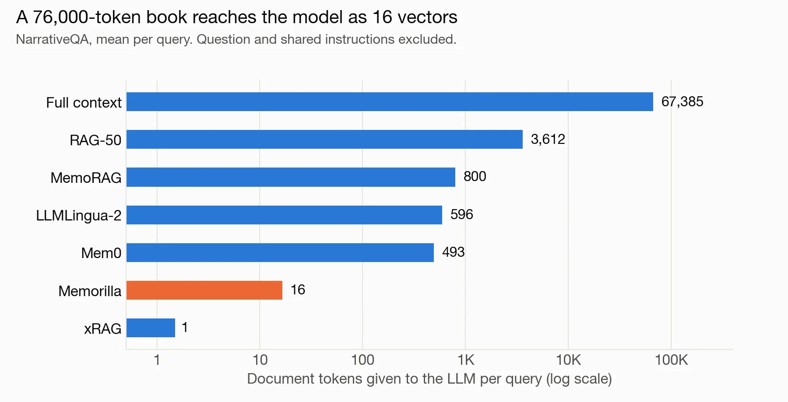
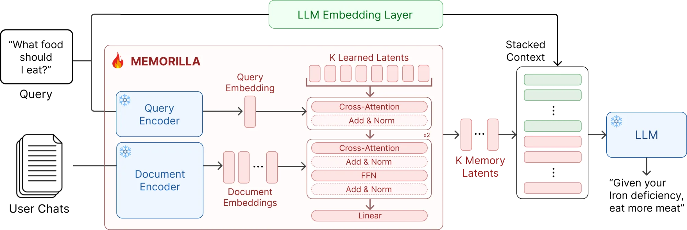
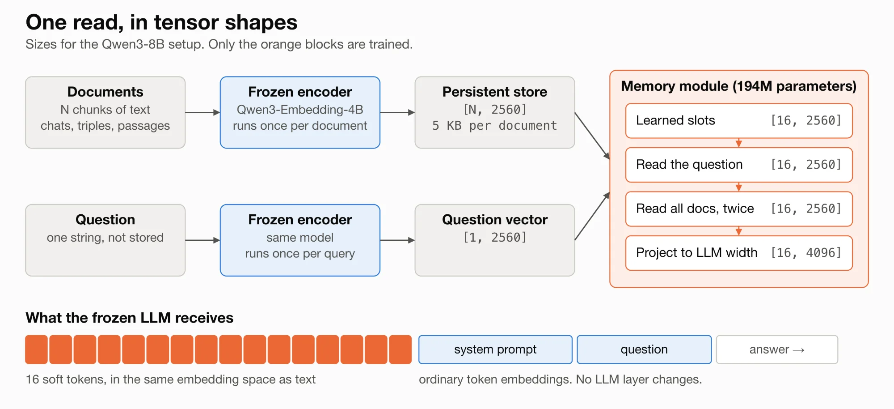
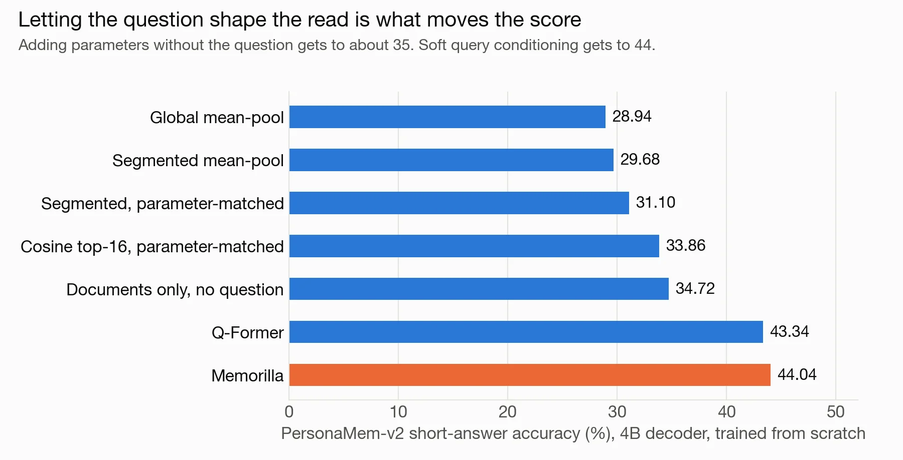
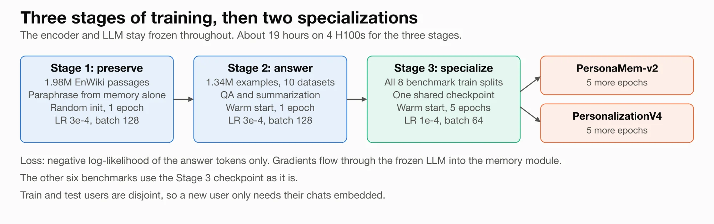
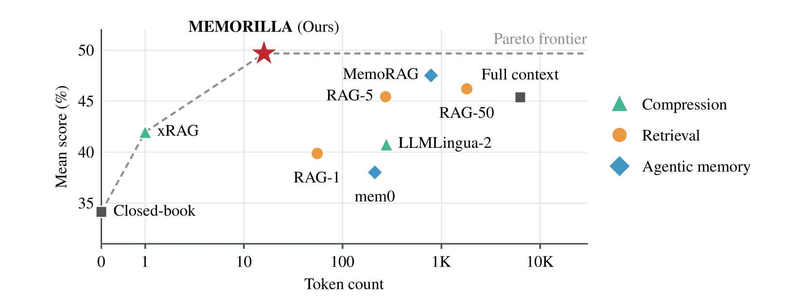
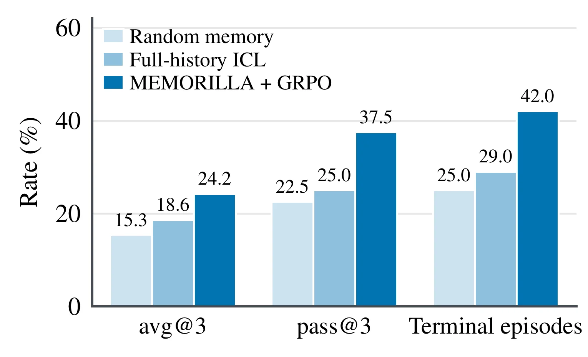
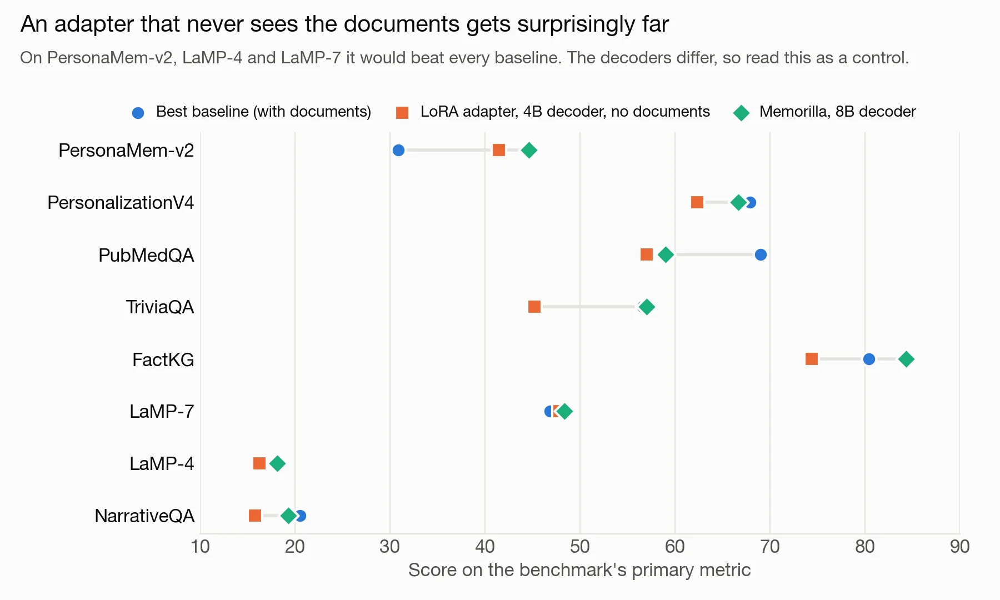
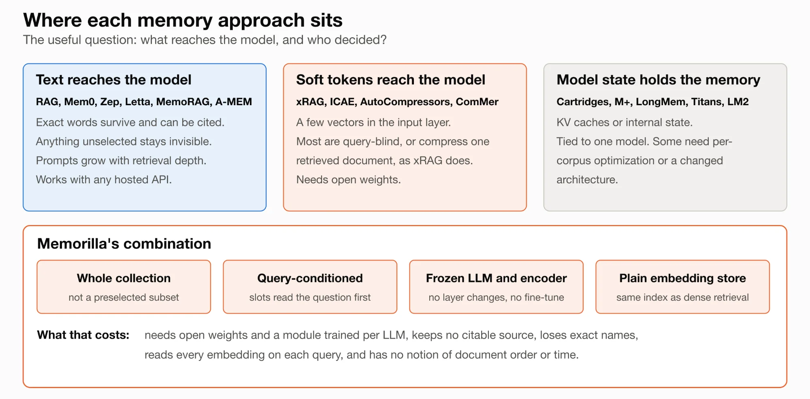

[Memorilla](https://arxiv.org/abs/2610.21375) is a new memory system for LLMs from Adibvafa Fallahpour, Parsa Idehpour, Vignesh Kothapalli, Nikita Mounier, Shirley Wu, Shayan Pardis, and Jure Leskovec. Rather than pasting retrieved text into the prompt, it reads a whole document collection and hands a frozen LLM a fixed set of 16 learned input embeddings. The [code](https://github.com/snap-stanford/memorilla), [weights](https://huggingface.co/memorilla/Memorilla-Qwen3-8B), and [data](https://huggingface.co/datasets/memorilla/Memorilla-Data) are all open today, with a released module for Qwen3-8B.

We are not part of the Memorilla team. This post is our independent early look at the release, and "we" below refers to our own reading and our own reproduction work. Here are a few highlights:

- **Fixed token budget:** The LLM receives 16 soft tokens however large the collection grows. On NarrativeQA that means 16 document tokens per query against 67,385 for full context, or 4,212x fewer. On FactKG it means 108x fewer.
- **Collection-wide reads:** There is no top-k cutoff. Each query attends over every stored document embedding, so evidence that looks nothing like the question can still reach the model.
- **Reusable store:** Each document is encoded once with a frozen encoder. A new user needs no retraining, so one module serves every user of the same LLM.
- **Trained through a frozen LLM:** The module of 194,123,776 parameters is trained through the LLM's gradients, using answers or game rewards. The LLM's own weights never change.
- **Early performance:** Memorilla reaches a mean score of **49.68** across eight benchmarks against 47.52 for MemoRAG, with **16 tokens against 784** in geometric mean. It stays at **0.74 s** per query at 512 documents, where full context takes 19.93 s on one H100.
- **Early caveats:** A LoRA adapter that sees no documents at all reaches 41.48 on PersonaMem-v2, against 44.60 for Memorilla and 30.90 for the best baseline. We cover what this means in [Performance](https://file+.vscode-resource.vscode-cdn.net/Users/moinuddin/Documents/AIYatra/aiyatra-blog/MemorillaBlog/article-vllm-style.md#performance).

## **What Memorilla changes for LLM memory**

<figure class="post-figure" data-size="wide"><figcaption>Figure 1. Document tokens each method gives the LLM per query on NarrativeQA. Chart by AIYatra, data from Table 10 of the Memorilla paper</figcaption></figure>

Once training ends, an LLM only knows what fits in its context window. Full context pastes everything in, which raises inference cost and can also hurt quality as the prompt grows ([*Lost in the Middle*](https://arxiv.org/abs/2307.03172), [*Context Length Alone Hurts LLM Performance*](https://arxiv.org/abs/2510.05381)). Retrieval keeps the prompt small, but it only surfaces chunks that resemble the question. Memory layers such as [Mem0](https://arxiv.org/abs/2504.19413) and [MemGPT](https://arxiv.org/abs/2310.08560) organize stored information much better, though they still select some text and place it in the prompt.

Memorilla replaces that selection step with a small trained network. Take the example in the project's [README](https://github.com/snap-stanford/memorilla/blob/d8f1889/README.md). A user with 107 past conversations, about 32,000 tokens in total, asks for easy breakfast ideas that keep them full all morning. A frozen Qwen3-8B then opens its answer with:

> Since you've got a family history of type 2 diabetes, you might enjoy breakfasts that balance protein, healthy fats, and fiber to keep you full without spiking blood sugar...

The user never stated that history. The only clue is one old chat asking whether diabetes on the mother's side raises a person's risk more than on the father's side, which shares nothing obvious with a question about breakfast. The model did not receive that chat as text, either. It received 16 vectors.

### **The Memorilla architecture**

<figure class="post-figure"><figcaption>Figure 2. Overview of the Memorilla architecture. Snowflakes mark frozen components and the flame marks the trained one. Source: Fallahpour et al., Memorilla repository, assets/architecture.png, Apache 2.0.</figcaption></figure>

Memorilla delivers its fixed budget by separating storage, recall, and generation into three components, and only the middle one is trained.

**Store.** A frozen Qwen3-Embedding-4B encoder turns each chunk into one mean-pooled vector of 2,560 values. A 200-chat history becomes a 200 x 2,560 matrix of about 1 MB. This is the same work a dense retrieval index already does, so the write path adds no extra cost over RAG.

**Recall.** Sixteen learned slots first cross-attend to the question, then pass through two blocks of cross-attention and feed-forward layers that read all N documents, following the latent-array design of [Perceiver](https://arxiv.org/abs/2103.03206). Notably, every document gets some attention weight, however small.

**Generation.** A linear layer projects each slot from 2,560 to the 4,096 dimensions of Qwen3-8B, and the results overwrite 16 `<|memory|>` placeholder embeddings in the prompt. Everything after the LLM's embedding layer treats these soft tokens like any other input, which greatly simplifies serving: vLLM takes them through `enable_prompt_embeds=True`.

## **Memorilla release status**

The Memorilla release covers the training pipeline, the evaluation pipeline, checkpoints for each training stage, and a new benchmark. In this section, we highlight the query-conditioned read that drives the results, then the usability of the release and its training recipes.

### **Query-conditioned soft tokens**

<figure class="post-figure"><figcaption>Figure 3. One Memorilla read in tensor shapes for the Qwen3-8B setup. Diagram by AIYatra, based on Section 2 of the Memorilla paper and memorilla/memory.py</figcaption></figure>

The central design choice is that the slots read the question before they read the documents, as shown in Figure 3. The 16 learned slots are shared across all users and queries. A cross-attention step conditions them on the question embedding, and the conditioned slots then read the store, so the same store can answer different questions with different memory tokens. Since the module adds no positional encoding, the read treats the store as an unordered set.

<figure class="post-figure"><figcaption>Figure 4. Slot construction ablation on PersonaMem-v2, higher is better. Chart by AIYatra, data from Table 13 of the Memorilla paper</figcaption></figure>

Figure 4 compares seven ways of building the 16 slots with one training recipe. Parameters alone do not close the gap: a documents-only variant with 269M parameters reaches 34.72. Hard selection lags as well, with the 16 most similar documents and a full parameter budget reaching 33.86. Query conditioning with soft attention reaches 44.04, and Memorilla achieves this while dropping the self-attention of a BLIP-2-style Q-Former, saving 79M parameters. The trend continues on FactKG, where Memorilla scores 82.56 against 80.48 for the Q-Former.

To check these properties ourselves, we re-implemented the module in about 50 lines of PyTorch (`code/mini_memorilla.py`). The parameter counts match the paper exactly, at 190,190,080 for the 4B decoder and 194,123,776 for the 8B decoder. The output stays 16 x 4,096 from N=1 up to N=5,000, and shuffling 200 documents changes the output by at most 2.74e-06. That last result carries a practical consequence: unless the document text itself includes a usable date, the module has no way to tell which of two conflicting facts is newer.

### **Out-of-the-box usability**

The release is straightforward to try on suitable hardware. The quickstart needs Linux, CUDA, Python 3.11, and one 80 GB GPU, and it downloads about 25 GB of models. We list the commands in the [appendix](https://file+.vscode-resource.vscode-cdn.net/Users/moinuddin/Documents/AIYatra/aiyatra-blog/MemorillaBlog/article-vllm-style.md#appendix-running-memorilla).

**Weights and data.** `memorilla/Memorilla-Qwen3-8B` hosts the checkpoints for Stages 1, 2, and 3, plus specializations for PersonalizationV4 and PersonaMem-v2. `memorilla/Memorilla-Data` provides training and evaluation data with precomputed embeddings. The code is Apache 2.0.

**A new benchmark.** `memorilla/PersonalizationV4` has 149 synthetic users with 200 chats each, where every question requires combining at least two facts. It is released under CC BY 4.0.

**Model coverage.** Every supervised experiment pairs Qwen with Qwen, and a new LLM needs a new module. Because memory enters through input embeddings, Memorilla requires open weights and your own serving stack, so hosted text APIs are out of scope for now.

### **Three-stage training**

<figure class="post-figure"><figcaption>Figure 5. The Memorilla training curriculum. Diagram by AIYatra, based on Section 2.6 and Tables 1, 4, and 5 of the Memorilla paper</figcaption></figure>

Stage 1 teaches preservation: with 1.98M Wikipedia passages, the LLM must write a paraphrase from memory alone. Stage 2 teaches selective recall across 1.34M examples from ten sources, including SQuAD, DROP, MS MARCO, and CNN/DailyMail. Stage 3 fine-tunes a single checkpoint on the training splits of all eight benchmarks, with five more epochs each for PersonaMem-v2 and PersonalizationV4. The README puts the three stages at about 19 hours on four H100 80 GB GPUs, with about 310 GiB of data and embeddings to download.

## **Performance**

The authors evaluate Memorilla on eight benchmarks, with every method answering through the same frozen Qwen3-8B. The table below shows the primary metrics from Table 11 of the [paper](https://arxiv.org/abs/2610.21375).

| Benchmark (metric) | RAG-50 | Full context | Mem0 | MemoRAG | xRAG | LLMLingua-2 | **Memorilla** |
| --- | --- | --- | --- | --- | --- | --- | --- |
| PersonaMem-v2 (accuracy) | 26.72 | 27.92 | 27.48 | 28.76 | 30.90 | 26.92 | **44.60** |
| PersonalizationV4 (accuracy) | 65.78 | 59.12 | 65.07 | **67.88** | 62.64 | 52.14 | 66.65 |
| LaMP-4 (ROUGE-L) | 15.09 | 14.21 | 12.70 | 15.02 | 16.10 | 12.98 | **18.15** |
| LaMP-7 (ROUGE-L) | 43.77 | 43.71 | 43.68 | 44.00 | 46.84 | 43.73 | **48.37** |
| FactKG (accuracy) | 78.39 | 80.43 | 72.79 | 80.38 | 78.98 | 71.65 | **84.33** |
| PubMedQA (accuracy) | 67.00 | 67.00 | 24.00 | 67.00 | 36.00 | **69.00** | 59.00 |
| NarrativeQA (ROUGE-L) | 17.23 | 17.99 | 13.80 | **20.51** | 16.92 | 7.18 | 19.31 |
| TriviaQA (exact match) | 55.60 | 52.60 | 44.60 | 56.60 | 47.00 | 42.40 | **57.00** |
| **Mean** | 46.20 | 45.37 | 38.02 | 47.52 | 41.92 | 40.75 | **49.68** |
| **Tokens, geometric mean** | 1,808 | 6,301 | 212 | 784 | 1 | 278 | **16** |

<figure class="post-figure"><figcaption>Figure 6. Mean score against context length. Source: Figure 1 of Fallahpour et al., &quot;Memorilla: Latent Semantic Memory for LLMs&quot;, cropped from the PDF, CC BY 4.0</figcaption></figure>

On FactKG, Memorilla delivers 84.33% against 80.43% for full context, with 108x fewer document tokens. The gain shows up on claims that need several hops, such as "AGM-88 HARM is produced by a company that manufactures the ALV X-1" (from the [project site's walkthrough](https://memory.stanford.edu/)), where the linking company is never named. As claims compose more facts, RAG-50 falls from 78.7% to 51.8%, while Memorilla stays above 80%. On NarrativeQA, Memorilla leads RAG-50 by +4.91 ROUGE-L on "why" questions and +7.02 on "how", while RAG-50 leads by +3.45 on "who" and +2.93 on "which".

Memorilla trails on three benchmarks. On PubMedQA, four abstracts total only 324 tokens, so compression has nothing to offer. On NarrativeQA and PersonalizationV4, MemoRAG leads while using 50x and 690x more tokens.

The memory module's forward pass takes about 2 ms at both N=1 and N=512, and end-to-end latency holds at about 0.74 s while full context grows from 0.75 s to 19.93 s. The authors also train a version from game reward alone on TextWorld, using GRPO with 8 memory tokens. Figure 7 shows the results on held-out games.

<figure class="post-figure"><figcaption>Figure 7. TextWorld results on held-out games, where a frozen Qwen3-4B acts and only the memory module learns. Source: Fallahpour et al., Memorilla repository, assets/textworld_results.png, Apache 2.0</figcaption></figure>

Average success rises from 18.6% to 24.2%, while untrained memory falls below the baseline at 15.3%. These runs use 40 prompts with 3 samples each, so this is a promising proof of concept at a small scale.

### **Reading the early numbers**

These results are very encouraging, and the appendices of the paper give us several ways to read them more closely. The analysis in this section is ours rather than the authors'.

<figure class="post-figure"><figcaption>Figure 8. Appendix E.4 trains a rank-130 LoRA adapter on the same rows as Memorilla's per-task fine-tuning, with no documents at all. Chart by AIYatra, data from Table 11 and Figure 11 of the Memorilla paper</figcaption></figure>

**Task training.** The no-document LoRA in Figure 8 beats every baseline on PersonaMem-v2, LaMP-4, and LaMP-7, and its mean of 45.03 sits right beside full context at 45.37. The authors read this as evidence for Memorilla, since it leads on every primary metric, with PubMedQA and LaMP-7 within noise. The LoRA also uses the smaller 4B decoder, so the comparison is imperfect. We would add a second reading: a large share of the gap against untuned baselines likely comes from training on the task. RAG with a task-tuned decoder would be the fairer test, and it has not been published.

**One benchmark carries the average.** Without PersonaMem-v2, the means become 50.40 for Memorilla and 50.20 for MemoRAG, by our arithmetic. The token gap stays enormous, so the sturdiest claim is similar average quality with a tiny fraction of the tokens.

**Noise.** TriviaQA's 57.00 against 56.60 comes to two questions out of 500, and PubMedQA has only 100 questions. FactKG, with 9,041 claims and a 3.9-point lead, is well outside noise, and it is also the clean test against full context, since every prompt fits without YaRN.

**Tokens are not bytes.** Sixteen tokens at 4,096 values in bfloat16 come to 128 KiB per query, and a 200-chat store comes to about 1 MB. The real savings are in decoder compute and prompt length, rather than in storage.

**Scale.** The paper's largest measured collection is N=512. Cross-attention reads every document, so cost must eventually grow with N. On an Apple M4 CPU with random embeddings, we measured the module's forward pass at 41 ms for 512 documents and 5.03 s for 128,000. An H100 will be far faster in absolute terms, but a million-document corpus would likely need a retrieval pre-filter.

## **Memorilla and other memory systems**

<figure class="post-figure"><figcaption>Figure 9. The LLM memory landscape, grouped by what actually reaches the model. Diagram by AIYatra, drawing on Appendix A of the Memorilla paperThe field splits most cleanly on what reaches the model, as shown in Figure 9. The table below summarizes where each system stands today.  System	Approach	Strengths	Limitations Memorilla	Query-conditioned soft tokens from the whole store	Fixed 16 tokens, weak-signal recall, relational reasoning	Open weights required, no citations, loses exact names Dense RAG	Top-k similar chunks as text	Simple, exact, citable, scales with ANN	Misses weak-similarity evidence, prompts grow Mem0	Extracted facts, entities, multi-signal retrieval	Works with any LLM, mature product	Vendor reports its weakest scores on temporal tasks Zep / Graphiti	Temporal knowledge graph	Facts can expire without being deleted	Graph pipeline to run and pay for Letta / MemGPT	Agent-edited memory blocks plus archival storage	Transparent and inspectable	Blocks occupy context MemoRAG	Global memory generates retrieval clues	Best on PersonalizationV4 and NarrativeQA here	Large prompts xRAG	One retrieved document becomes one soft token	Extreme compression	Retrieval still decides, one bridge per benchmark LLMLingua-2	Deletes tokens from the prompt	No model change, readable output	Query-blind, poor on long collections here ComMer	Query-independent user compression	Personalization focus	Same tokens for every question Cartridges	KV cache trained per corpus	High throughput by its own measure	Offline optimization per corpus Two notes on this comparison. The paper's Mem0 baseline is mem0ai 0.1.118, and Mem0 has since replaced that algorithm, so its 38.02 says little about the version you would install today. Vendor numbers also do not transfer: Memorilla has not been evaluated on LoCoMo or LongMemEval, and current vendor systems have not been evaluated on PersonaMem-v2 or FactKG.</figcaption></figure>

The field splits most cleanly on what reaches the model, as shown in Figure 9. The table below summarizes where each system stands today.

| System | Approach | Strengths | Limitations |
| --- | --- | --- | --- |
| **Memorilla** | Query-conditioned soft tokens from the whole store | Fixed 16 tokens, weak-signal recall, relational reasoning | Open weights required, no citations, loses exact names |
| **Dense RAG** | Top-k similar chunks as text | Simple, exact, citable, scales with ANN | Misses weak-similarity evidence, prompts grow |
| [**Mem0**](https://mem0.ai/blog/mem0-the-token-efficient-memory-algorithm) | Extracted facts, entities, multi-signal retrieval | Works with any LLM, mature product | Vendor reports its weakest scores on temporal tasks |
| [**Zep / Graphiti**](https://arxiv.org/abs/2501.13956) | Temporal knowledge graph | Facts can expire without being deleted | Graph pipeline to run and pay for |
| [**Letta / MemGPT**](https://docs.letta.com/guides/agents/memory-blocks) | Agent-edited memory blocks plus archival storage | Transparent and inspectable | Blocks occupy context |
| [**MemoRAG**](https://arxiv.org/abs/2409.05591) | Global memory generates retrieval clues | Best on PersonalizationV4 and NarrativeQA here | Large prompts |
| [**xRAG**](https://arxiv.org/abs/2405.13792) | One retrieved document becomes one soft token | Extreme compression | Retrieval still decides, one bridge per benchmark |
| [**LLMLingua-2**](https://arxiv.org/abs/2403.12968) | Deletes tokens from the prompt | No model change, readable output | Query-blind, poor on long collections here |
| [**ComMer**](https://arxiv.org/abs/2501.03276) | Query-independent user compression | Personalization focus | Same tokens for every question |
| [**Cartridges**](https://arxiv.org/abs/2506.06266) | KV cache trained per corpus | High throughput by its own measure | Offline optimization per corpus |

Two notes on this comparison. The paper's Mem0 baseline is `mem0ai` 0.1.118, and [Mem0 has since replaced that algorithm](https://mem0.ai/blog/mem0-the-token-efficient-memory-algorithm), so its 38.02 says little about the version you would install today. Vendor numbers also do not transfer: Memorilla has not been evaluated on LoCoMo or LongMemEval, and current vendor systems have not been evaluated on PersonaMem-v2 or FactKG.

## **Next Steps**

Sixteen tokens on one model family is a strong first result, and the most interesting work is still ahead. The authors point to hybrid memory and retrieval, encoders trained for compression, transfer across model families, multimodal stores, and one store serving multiple LLMs. On FactKG, 15.9% of questions are answered by Memorilla alone and 10.0% by RAG-50 alone, so the hybrid direction looks especially promising. From our side, we would most like to see the community:

- Run RAG on a task-tuned decoder against Memorilla.
- Give each PersonaMem-v2 question another user's store, to isolate what personal memory contributes.
- Evaluate Memorilla on LoCoMo, LongMemEval, and a test built around changing facts.
- Extend quality and latency measurements beyond N=512.
- Test abstention, since a fixed token budget gives the model no signal that information is missing.
- Study memory poisoning, since attacker text in the store influences vectors that are harder to audit than retrieved text.
- Keep vLLM patched and compute memory tokens server-side. Public endpoints should never accept raw embeddings from clients, and vLLM's prompt-embedding path had [CVE-2025-62164](https://cvefeed.io/vuln/detail/CVE-2025-62164).

## **Acknowledgements**

Memorilla is the work of its authors, and this post only reports on it. We would like to extend thanks to:

- The Memorilla authors, for releasing the code, weights, and data, and for publishing the controls that made this closer reading possible.
- The maintainers of the baseline systems and benchmarks used in the evaluation.
- The Qwen and vLLM projects, whose models and serving stack the release builds on.

Image credits and the URL of every source are listed under [Resources](https://file+.vscode-resource.vscode-cdn.net/Users/moinuddin/Documents/AIYatra/aiyatra-blog/MemorillaBlog/article-vllm-style.md#resources).

## **Appendix: running Memorilla**

We did not run the official model for this post, because it needs Linux and an 80 GB GPU. The commands and flags below are from the project's README and source at commit `d8f1889`. We did run the re-implementation below, on a laptop.

Installation:

```bash
git clone https://github.com/snap-stanford/memorilla.git && cd memorilla
uv venv --python 3.11 && source .venv/bin/activate
uv pip install -e .
uv pip install --no-build-isolation flash-attn==2.7.4.post1   # used by training; evaluation does not need it
```

Inference on a PersonaMem-v2 example:

```python
from memorilla.benchmarks import PERSONA_PROMPT
from memorilla.data import ensure_data, load_split
from memorilla.vllm import MemoryVLLM

row = load_split("pmv2", "test", ensure_data("pmv2", ["test"]))[73]
model = MemoryVLLM.from_pretrained("memorilla/Memorilla-Qwen3-8B", "pmv2")
answer = model.answer(row["question"], row["documents"], system_prompt=PERSONA_PROMPT)
print(f"Question: {row['question']}\nMemorilla: {answer}")
```

The relevant configurations are:

- Training on your own data. Write one parquet file per split with `collection_id`, `question`, `answer`, and `documents`, then run `python train.py --config configs/single_task.yaml --data_repo my_data --datasets my_task --output_dir runs/my_task`. This recipe warm-starts from Stage 2.
- Evaluation. Run `python evaluate.py --data_repo my_data --config my_task --split test --scoring generation --checkpoint runs/my_task/epoch-04`. We also recommend running the baselines and a no-document control on your data.
- Stage 1 recipe. `configs/stage1_enwiki.yaml` sets `learning_rate: 3.0e-4`, `max_epochs: 1`, `batch_size: 4`, `gradient_accumulation_steps: 8`, and `devices: 4`.
- Reusing the store. `model.answer()` re-embeds every document on each call, which is fine for a demo. In production, save the output of `embed_texts` once and pass it to `model.generate` as `doc_embeds`.

The core of the memory module, from our re-implementation:

```python
def forward(self, docs, question, padding_mask=None):
    """docs: [batch, N, enc_dim]; question: [batch, enc_dim]; returns [batch, K, llm_dim]."""
    q = question.unsqueeze(1)
    slots = self.slots.expand(docs.size(0), -1, -1)

    attended, _ = self.q_attn(slots, q, q)
    slots = self.q_norm(slots + attended)

    docs = self.doc_norm(docs)
    for attn_norm, attn, ffn_norm, ffn in zip(self.attn_norms, self.attns, self.ffn_norms, self.ffns):
        attended, _ = attn(attn_norm(slots), docs, docs, key_padding_mask=padding_mask)
        slots = slots + self.drop(attended)
        slots = slots + ffn(ffn_norm(slots))

    return self.proj(self.out_norm(slots))
```

## **Resources**

### **Image credits**

- **Cover, Figures 1, 3, 4, 5, 8, and 9:** made by AIYatra for this post, using the data and sources named in each caption.
- **Figure 2:** Fallahpour et al., Memorilla repository, Apache 2.0: <https://github.com/snap-stanford/memorilla/blob/d8f1889/assets/architecture.png>
- **Figure 6:** Figure 1 of Fallahpour et al., "Memorilla: Latent Semantic Memory for LLMs", cropped from the PDF, CC BY 4.0: <https://arxiv.org/pdf/2610.21375>
- **Figure 7:** Fallahpour et al., Memorilla repository, Apache 2.0: <https://github.com/snap-stanford/memorilla/blob/d8f1889/assets/textworld_results.png>
- **CC BY 4.0 license:** <https://creativecommons.org/licenses/by/4.0/>
- **Apache 2.0 license:** <https://www.apache.org/licenses/LICENSE-2.0>

### **Memorilla**

- Memorilla: Latent Semantic Memory for LLMs (arXiv): <https://arxiv.org/abs/2610.21375>
- Memorilla paper (PDF): <https://arxiv.org/pdf/2610.21375>
- Project site: <https://memory.stanford.edu/>
- GitHub repository: <https://github.com/snap-stanford/memorilla>
- README, at the commit we read: <https://github.com/snap-stanford/memorilla/blob/d8f1889/README.md>
- Memory module source, at the commit we read: <https://github.com/snap-stanford/memorilla/blob/d8f1889/memorilla/memory.py>
- Hugging Face organization: <https://huggingface.co/memorilla>
- Memorilla-Qwen3-8B weights: <https://huggingface.co/memorilla/Memorilla-Qwen3-8B>
- Memorilla-Data dataset: <https://huggingface.co/datasets/memorilla/Memorilla-Data>
- PersonalizationV4 dataset: <https://huggingface.co/datasets/memorilla/PersonalizationV4>
- Post on X from co-author handle kvignesh1420: <https://x.com/kvignesh1420/status/2118434400904069492>

### **Other memory systems**

- Mem0: Building Production-Ready AI Agents with Scalable Long-Term Memory: <https://arxiv.org/abs/2504.19413>
- Mem0, token-efficient memory algorithm post: <https://mem0.ai/blog/mem0-the-token-efficient-memory-algorithm>
- Zep: A Temporal Knowledge Graph Architecture for Agent Memory: <https://arxiv.org/abs/2501.13956>
- MemGPT: Towards LLMs as Operating Systems: <https://arxiv.org/abs/2310.08560>
- Letta memory blocks documentation: <https://docs.letta.com/guides/agents/memory-blocks>
- MemoRAG: Boosting Long Context Processing with Global Memory-Enhanced Retrieval Augmentation: <https://arxiv.org/abs/2409.05591>
- xRAG: Extreme Context Compression for Retrieval-augmented Generation with One Token: <https://arxiv.org/abs/2405.13792>
- LLMLingua-2: Data Distillation for Efficient and Faithful Task-Agnostic Prompt Compression: <https://arxiv.org/abs/2403.12968>
- ComMer: a Framework for Compressing and Merging User Data for Personalization: <https://arxiv.org/abs/2501.03276>
- Cartridges: Lightweight and general-purpose long context representations via self-study: <https://arxiv.org/abs/2506.06266>

### **Background and benchmarks**

- Perceiver: General Perception with Iterative Attention: <https://arxiv.org/abs/2103.03206>
- Lost in the Middle: How Language Models Use Long Contexts: <https://arxiv.org/abs/2307.03172>
- Context Length Alone Hurts LLM Performance Despite Perfect Retrieval: <https://arxiv.org/abs/2510.05381>
- PersonaMem-v2: Towards Personalized Intelligence via Learning Implicit User Personas and Agentic Memory: <https://arxiv.org/abs/2512.06688>
- DeepSeekMath: Pushing the Limits of Mathematical Reasoning in Open Language Models (introduces GRPO): <https://arxiv.org/abs/2402.03300>
- TextWorld: A Learning Environment for Text-based Games: <https://arxiv.org/abs/1806.11532>
- Evaluating Very Long-Term Conversational Memory of LLM Agents (LoCoMo): <https://arxiv.org/abs/2402.17753>
- LongMemEval: Benchmarking Chat Assistants on Long-Term Interactive Memory: <https://arxiv.org/abs/2410.10813>

### **Security and format**

- CVE-2025-62164 record: <https://cvefeed.io/vuln/detail/CVE-2025-62164>
- vLLM security advisory GHSA-mrw7-hf4f-83pf: <https://github.com/vllm-project/vllm/security/advisories/GHSA-mrw7-hf4f-83pf>
- vLLM blog post whose format this post follows, "vLLM Support for NVIDIA Vera Rubin NVL72": <https://vllm.ai/blog/2026-10-09-vera-rubin-preview>
